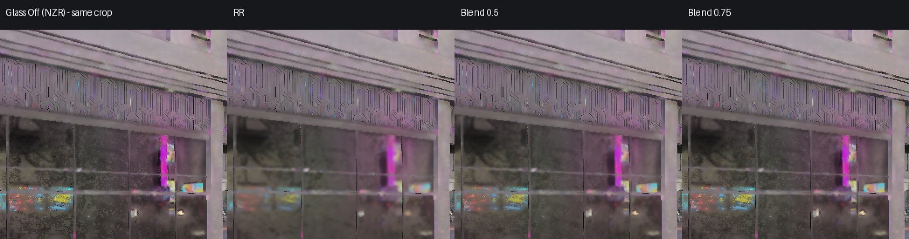
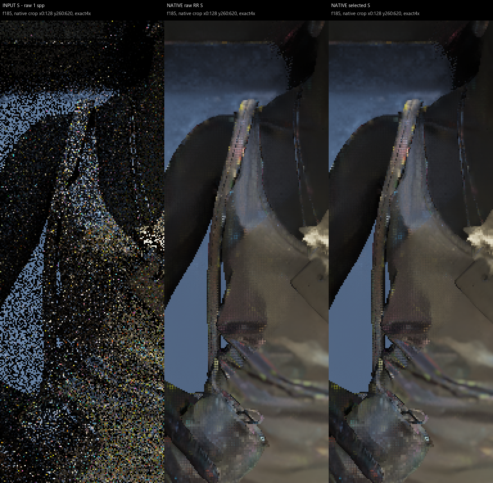
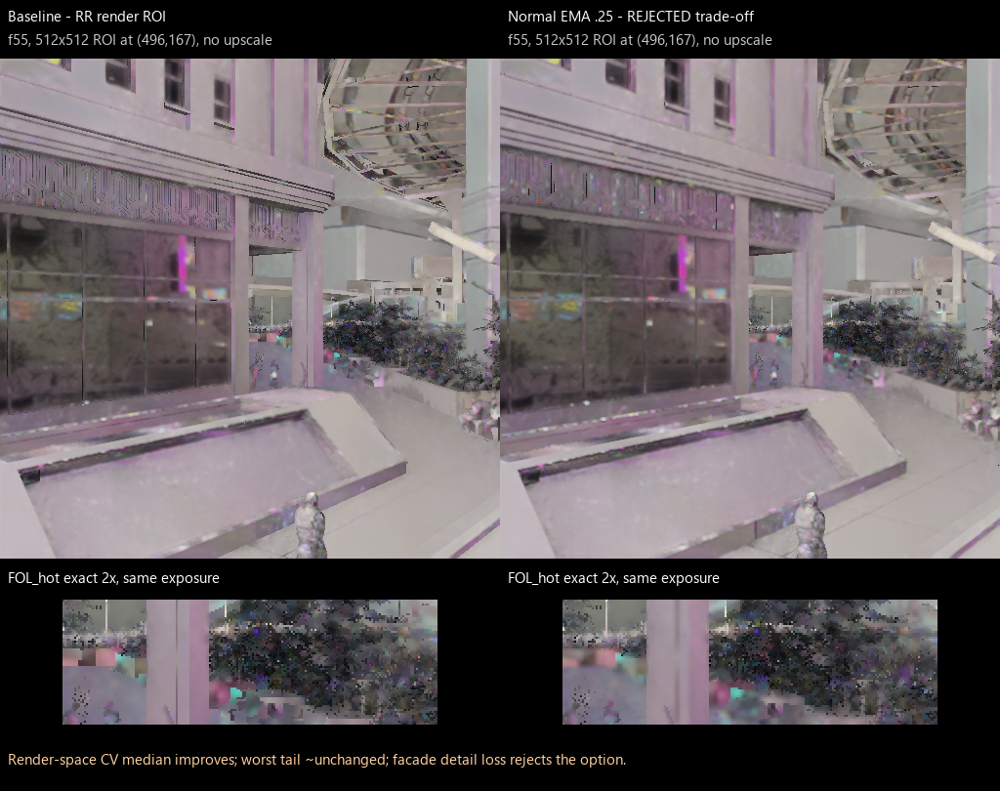
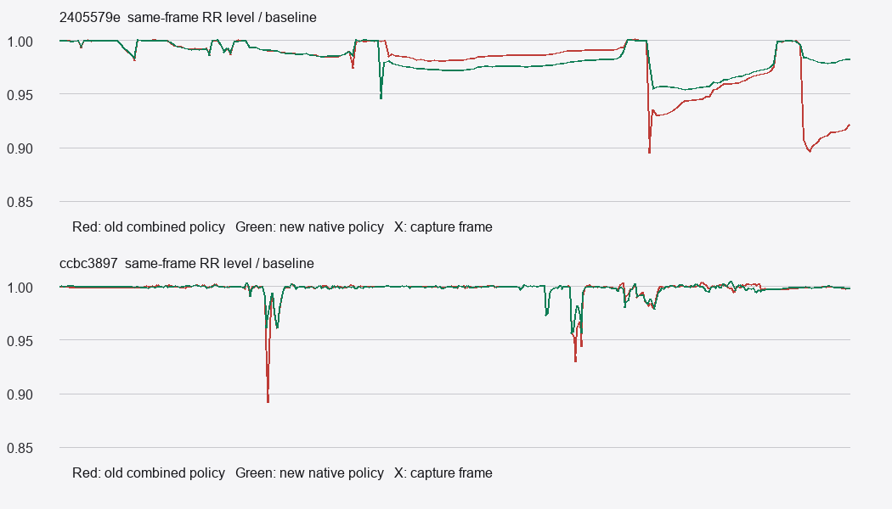

# Independently audited findings and remaining failures

Production baseline: `87e8b7ab2a428bd91d3c044decf7d4dbccd8cefd`.
These are local 2026-10-20 measurements; cloud authors must not report them as
their own executed tests. For detailed test scopes inspect evidence JSON.

## Correctness repairs already made

Task24 Glass fallback now uses exact lerp for partial strength instead of max.
PostFlick invalid viewport history and odd extents were repaired. Colour history
normal encoding changed from an unsafe 16-bit FP16 payload to exact 11-bit data;
allocation UV, source authority, reset and invalid-history handling were fixed.
Anchor repairs include actual GPU settled keys, matching camera/physical slots,
clearing invalid cells, UAV ordering, reset upload lifetimes and six physical
ring slots. Native integration retains owned private D/S copies through fences,
uses split 16.16 uint sums and charges the same shared family budget. Trace
exports full-resolution input and one-eighth gain at their own extents.

## Strong correctness evidence, limited quality conclusions

- Native integration harness: 240 frames, 9,596,644 checks, D3D debug 0/0.
  Actual Configure/RecordOwned/input-copy/CommitOwned, but a mock RR provider.
  A forced-OFF mutant fails. This does not certify AMD image quality.
- Shared family budget harness: 282 checks, actual wrappers and extracted
  coordinator predicates; it does not compile the entire Service translation unit.
- Native trace odd-size test: 137x131 input, 128x128 ROI, 17x16 gain; 230 native
  and 231 Python checks. OFF golden comparison: 312 files / 28,320,861 bytes,
  four profiles, 24 frames, deterministic provider.
- 107 generated headers / 971 checks; 11 fresh CSOs matched exact DXC1.8 bytes.
  Two historical DXC1.9 headers differed in metadata while IR matched; rebuilt
  using1.8 and local GPU checks passed. Use matching compiler before byte claims.

## Anchor: correctness improved, effect not accepted

Actual native-policy CSOs followed by fresh AMD RR ROI evaluation covered five
captures/882 frames plus small light changes. Excess level for87ee went
1.072622→1.043282 (40.4% excess removed),22f9 1.146582→1.092408 (37.0%).
Both miss the50% target. The late input reference is not ground truth.
Local identity fallback improved moving NPC f210 ratio .86635→.99982 and
driving f106 .89160→.97137, but residual worst moving/whole-region losses remain
about3–5%. Grid identity still permits bilinear gain leakage across boundaries.
Real1.1/1.25x RGB changes had22-frame response areas .9336/.8997 of baseline:
these are response delays/losses, not whole-image brightness reductions.
Equal-global-energy antithetic residuals expose one-sided darkening bias.
Captured residuals are not pure Monte Carlo noise; ReSTIR causality is unproved.
These quality replays are not a full game G3V20.1+native host+NZR validation.

## Colour: strong negative controls

A raw-dark guard raised flicker35.4%. DenserC8/JBU/soft-fallback reduced some
noise11–13% and d6 by57% versusB4, but d6 still exceeded raw by16.3%.
GPU phase-shifted edge leakage worsened70–71%: reject that soft2 candidate.
C4 with the same physical footprint worsened14/32 edge phases; d6 still raw+48%
and flicker improvement only4%. Ideal CPU bilinear mismatched hard depth gates
on9/4096 samples because D3D's sampler quantizes fractions. Actual sampled
history evaluated by the independent formula matched within one FP16 ULP.
One-frame CPU-warmed GPU parity must never be renamed full GPU temporal proof.

## Glass: useful grain reduction with detail cost

87ee f46–63, identical8048-pixel support: Blend.5 fine temporal CV
.08864→.06497 (26.7% lower). The detail-energy proxy fell25%; Blend.75 fell13%
and direct RR45%. Diffuse equality checked18,874,368 words with0 changes.
A301-frame puddle control had zero gate overlap. This supports an optional
Blend.5 A/B, not a claim of lossless denoising. Native Temporal staysOFF.

## Bottle and foliage: do not optimize the wrong cause

Moving bottle raw/selected D/S matched bitwise18/18 cases over f178–186.
Input bright support already contains streaks; RR makes a continuous stripe.
Without same-pose converged truth, its physical shape is unresolved. Resetting
history at f183 reduced level18.3% and high-frequency energy38.8%; after level
matching high-frequency still fell25.1%: not proof of shape improvement.
Roughness zero made grain4–8x worse. Normal alignment preferred the correct1x
MV while radiance self-alignment could prefer incorrect1.5x.

Foliage changed-denominator CV falsely claimed11% improvement; fixed baseline
support gave1.6% median improvement and8.4% p90 worsening. NormalEMA.25 improved
a local median8.5% but lost22–27% facade detail and worsened fine flicker in22f9.
Zero material IDs cannot identify foliage/glass semantically.

## Performance scope

Glass uses the existing HybridApply, no new pass/allocation. Paired1440p local
increment .00264ms versus sham drift .00160ms. This does not prove full-game
<=1ms. Native Anchor measured +.14908ms active, +.04284 refresh and +.00104 inert;
the complete Anchor allocation adds64.125MiB at that allocation. Its two private
full-size RGBA16F textures account for57.5MiB of that total.
Resident VRAM and opaque AMD provider costs are unmeasured. Existing build
warnings remain; the package is not a warning-free or artifact-free claim.

## Images

All images are historical diagnostic comparisons, not new proposed results:

