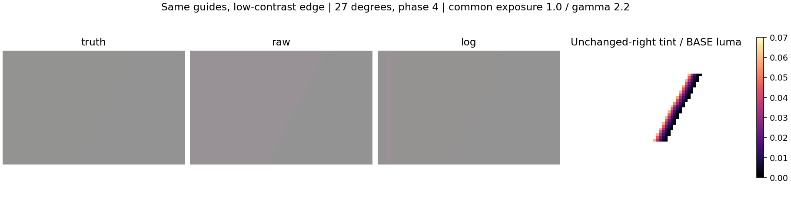

# Local audit of the seven Astra returns — 2026-10-20

**Verdict: retain as research and integration inputs. No returned algorithm is
approved for default enablement or claimed to produce a clean game image.**

The six PRs and unpublished colour ZIP are aggregated without changing their
559 files. [INTAKE.json](INTAKE.json) records their exact source revisions and
hashes. The ZIP SHA-256 is
`d17fd9cd4cde60bf803f7786320111b37146e2faff90ff1fde1ea8380d7ffce4`.
All 99 entries of its checksum manifest matched. Applying its patch to the
frozen handoff in an isolated Git index produced the advertised tree
`4504233cffc38624d7db1966173fd2bc2c5c5c5e`; its 95 source files matched that patch.
Original intake is commit `351ceae2251fffbc62498260fb4354886a0dd76d`.

This audit did not rewrite old receipts to make them look independently executed.
Labels such as "root", "independent reviewer", or "Codex authored" in incoming
files are not evidence of authorship or validation. Fresh local execution is
identified separately below. Subagents handed off their findings and stopped at
the user's allowance-conservation request; the root completed the remaining runs.

## What was actually rerun

- All seven candidate unit suites: 125 numerical, 14 anchor, 24 colour,
  55 geometry, 35 glass, 41 bottle, 36 foliage tests = **330 tests**.
- Independent anchor reviewer: **12 tests**. Numerical adversary controls:
  **1 additional unittest**. Total **343**, excluding the four frozen baseline
  suites, which also passed. The final aggregate command completed **21 stages**.
- Five deliberately wrong numerical implementations and the glass alpha mutation
  exited 1 with actual assertion failures. Those are successful detections of
  broken implementations, not successful candidate outputs.
- All 91 frozen package entries and 141 NPZ arrays passed the original validator.
  The 559 imported files remained hash-identical after execution.
- Glass snapshot verification, independent phase/correlation/glint tests and
  saved holdout arithmetic checks passed. The entire glass holdout experiment was
  **not** independently regenerated; its aggregate arithmetic was checked.
- The original native-colour synthetic review was recomputed on local Windows
  CPU in a disposable worktree: **exit 1**, again failing
  `primary_log_diffuse_true_step_response_below_0.90`.
- Its separate low-contrast follow-up was also recomputed: **32/32 cases**
  exceeded the original storage-error envelope in the unchanged right-side band.
  Worst log-candidate contamination was **0.06265256305939788** relative to the
  test's BASE-luma-normalized RGB metric. This is a synthetic counterexample,
  not a percentage of in-game visual harm or an entire image average.

Fresh logs, commands, elapsed times and hashes are in
[CPU execution](evidence/root_cpu_final/execution.json),
[local quality provenance](evidence/colour_quality/LOCAL_EXECUTOR.json),
[quality results](evidence/colour_quality/review_result.json), and
[low-contrast results](evidence/colour_quality/low_contrast_results.json).
Upstream scripts hardcode executor names in their JSON; LOCAL_EXECUTOR.json
corrects that attribution without editing the returned snapshots.



The panel is the retained original rendering; Matplotlib was unavailable in the
local runtime. Every underlying array was reproduced bit-for-bit by the fresh
computation and checked before reusing this figure. See LOCAL_EXECUTOR.json.

## Local GPU and compiler evidence

DXC 1.8.2502.11 compiled all five actual HLSL proposals (numerical guard, native
colour, support-certified apply, glass uncertainty, foliage observation).
The anchor file is explicitly pseudocode and was not compiled. The numerical
shader emitted an existing `#pragma once in main file` warning; the other four
compile logs were empty. [Compilation receipts](evidence/adapter_compile/execution.json).

On **AMD Radeon RX 9070**, the unmodified packed colour shader ran five D3D12
canaries: OFF, strength0, active log, active linear and invalid geometry. Tests
used active 13x9 inside allocation 17x12, four distinct padded row pitches and
copy offsets, explicit R32_UINT authority, protected RGB and alpha mutations,
and half alpha NaN payloads/signed zero. All five passed:

- CPU/GPU RGB half words matched exactly in these inputs (gate allows 1 half ULP).
- Alpha, protected selected pixels, inactive extent, row padding and buffer
  canaries were unchanged. OFF/strength0/invalid geometry were full-word identity.
- Both active modes changed 114 eligible pixels, so those checks were not vacuous.
- D3D12 debug layer was enabled with **0 errors and 0 warnings**.

[GPU result](evidence/root_gpu_fixed/gpu_result.json) binds shader, compiler,
executable and test-script hashes. `gpu_colour.py` is the reproducible test.
The generic runner now supports R32_UINT, required by the explicit authority
texture. These are **small synthetic mechanical checks**: no native host graph,
real RR replay, separate D16/S256 conversion path, full-scale performance, dynamic
resource lifecycle or in-game visual acceptance was exercised. Those remain
release gates. No DLL was built or installed for this research-only aggregation.

## Findings and disposition

1. **Numerical contracts:** useful executable sampling/storage/accumulator
   checks. The finite-depth production proposal applies cleanly to an isolated
   source copy and compiles. It remains an unapplied proposal, not a shipped fix.
2. **Anchor:** the returned accepted path deliberately emits gain=1. Its
   provisional estimator was rejected. Passing tests therefore proves abstention
   and contracts, not better post-flick recovery. Full matched-dose experiments
   were not independently regenerated in this audit.
3. **Native colour:** mechanical transport works in the tested GPU cases, but
   the recomputed quality rejection and low-contrast boundary leak remain.
   Strong high-contrast guide rejection does not establish separation of subtle
   real boundaries from noisy RR chroma. Do not enable it as a quality fix.
4. **Geometry transport:** the CPU model and supplied apply shader are useful;
   a native GPU producer for the actual estimator's full donor-support certificate
   is still missing. A current-cell tag cannot repair a gain already contaminated
   by its neighbouring/recalled donors. The typed float4 apply path has not proved
   arbitrary alpha payload preservation. No native integration was established.
5. **Glass:** the Haar uncertainty candidate remains rejected. Missing sidecar
   observations make the recorded real-clip path abstain. Saved holdout arithmetic
   is consistent, but that is not an independent quality adoption result. Preserve
   the established user-selectable GlassBlend behavior and defaults.
6. **Bottle:** useful diagnostic and coordinate/mask tests; raw/selected equality
   does not identify the moving-bottle artifact's cause. No corrective algorithm
   or image-quality win was delivered or validated here.
7. **Foliage:** a read-only observer, with a rejected cosine-based consumer.
   Native normal/roughness cannot be treated as a proven material/leaf identity
   or a converged guide. No validated foliage repair was delivered.

## Harness corrections and limits

The old GitHub CPU workflow ran only the four original baselines. It did not
test any returned candidate. The updated workflow runs the aggregate entrypoint
and publishes logs. It reports CPU contract execution, never visual acceptance.

Original one-command scripts are retained as historical artifacts. For current
verification use `run_cpu.py` in this directory: it uses `sys.executable`, explicit
UTF-8, isolated import paths, actual platform metadata, separate output directories,
and verifies the imported snapshots before and after execution. This avoids the
job01 literal `python` and hardcoded Linux labels, job04 hardcoded Linux labels,
job03's incorrect "all other candidate directories are forbidden" scope check,
and job05's Windows locale decoding failure. It does not disable integrity checks:
all original snapshot hashes and the frozen package checks remain enforced.

The original numerical and glass adapters compared Git LF blobs to CRLF working
files and incorrectly called them source changes. `verify_adapters.py` allows
**only CRLF/LF differences**, rejects content/whitespace mutations, applies both
patches in temporary storage with `core.autocrlf=false`, and verifies their exact
result bytes/hashes and protected sources. Production files are untouched.

First attempts are retained under `evidence/first_attempts/`. The local GPU test
initially read nonexistent counter names (`errors` instead of `validation_errors`)
and falsely marked otherwise debug-clean runs as failures. The corrected test was
rerun; the final five cases passed. The second adapter attempt exposed Git's
global autocrlf conversion while applying a patch, also corrected and rerun.

Incoming PR formatting checks were red while their production trees were still
the unchanged frozen baseline; the separate full-tree clang-format debt is not
fixed or suppressed by this research aggregation. Do not report every CI check
as green. No exhaustive reread of every incoming report, rerun of every expensive
experiment, causal bottle/foliage diagnosis, or final-game visual acceptance is
claimed. Those boundaries are deliberate and explicit.

## Reproduce and continue

Install the frozen NumPy requirement, then run from repository root:

```text
python research/astra20261020/audit_round2/run_cpu.py --output <scratch-directory>
```

For Windows GPU verification, acquire the shared local GPU lock and run:

```text
python research/astra20261020/audit_round2/gpu_colour.py --output <scratch-directory>
```

Do not rerun output-writing historical scripts in the immutable candidate
directories; use a disposable worktree. The colour review additionally needs
Matplotlib for its panels. [NEXT.md](NEXT.md) contains three deep integration
assignments: jobs09 and10 can run concurrently; job11 consumes their actual
outputs and prepares the next local GPU gate. No rejected method is promoted.
