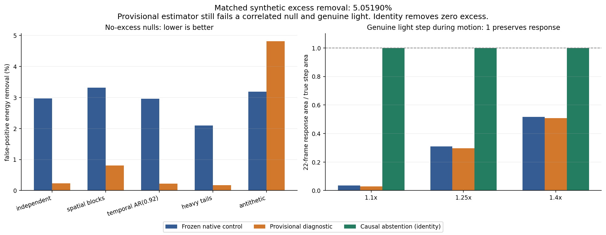
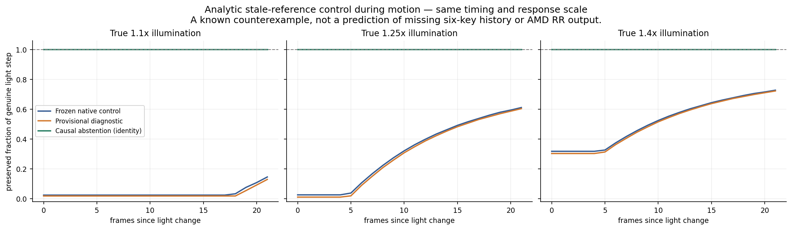
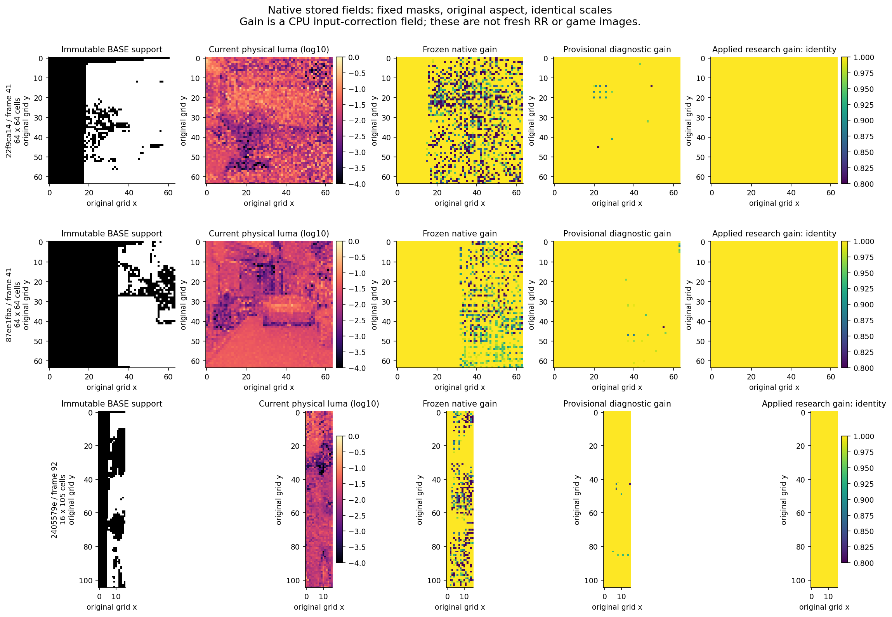
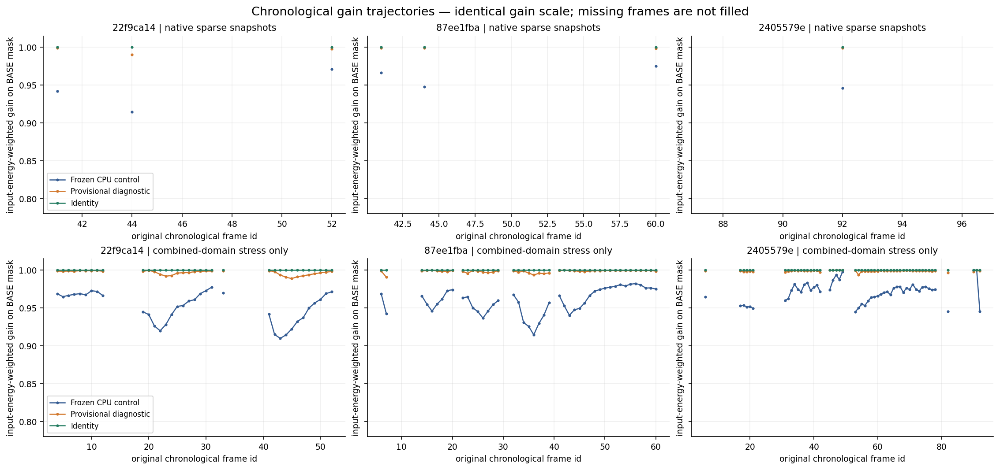

# Native anchor estimation: useful diagnostics, rejected active correction

## Decision and delivered result

**Keep this work as research. Reject `provisional_gain` as an active input
correction.** The implemented deployable output is an explicit identity
abstainer: it preserves the current physical input when the observations cannot
identify the cause of a level change. Its zero correction dose is a loss of all
possible excess correction, not an image-quality improvement.

The paired-log diagnostic reduces false-positive darkening in several independent
noise controls at matched removal of a labeled synthetic excess. It nevertheless
**increases darkening in an equal-energy correlated control and still removes
genuine 1.1/1.25/1.4 illumination changes**. An independent skeptical reviewer
reproduced those failures after freezing the implementation. This supplies a
tested mechanism, code, rejection controls, data inventory, exact adapter
specification and a narrow request for the missing observation. It does not
justify changing the user's Anchor-OFF recommendation.

All new files are in `research/astra20261020/candidates/02-anchor-estimator/`.
No production, baseline-reference, other-job, DLL, UI/default, native routing or
shared history file changed. Source-shaped pseudocode is supplied instead of
an enabled production patch. No HLSL compiler, Windows/D3D12 test, GPU, fresh AMD
RR or game execution occurred. Historical GPU fields remain calibration
witnesses. [Evidence: execution ledger](evidence/run_ledger.json),
[independent verdict](reviewer/REVIEW.md), [adapter](adapter/ESTIMATOR_SPEC.md).

## 1. Source authority and reproducibility

The checkout began at immutable annotated tag `astra-handoff-20261020`, resolved
to **`5d7839a930106cf8fe1ba8dbbc6750509e7f26a8`**. The audited production parent
is **`87e8b7ab2a428bd91d3c044decf7d4dbccd8cefd`**; these commits are deliberately
not conflated. Work uses branch `astra/02-anchor-estimator` and targets
`sol/26-integration`.

Before candidate implementation, the implementation owner ran the unmodified
package validator and CPU entry point. They passed: **91 frozen files, 141 safe
NPZ arrays**, and all four portable suites. Initial logs and elapsed times are
preserved separately from the final coordinator rerun. A passing baseline suite
also means its known failures were reproduced, not that the estimator was
approved. Python3.12.14 and NumPy2.3.5 met the handoff dependency contract.
Matplotlib3.10.8 is used only for exported figures.
[Initial execution](evidence/baseline/runs.json),
[original CPU output](evidence/baseline/run_cpu.txt).

Development used `22f9ca14`; `87ee1fba` was validation. Both native and combined
`2405579e` NPZ arrays were reserved for held-out candidate evaluation. Eleven
source, test, protocol and adapter hashes were recorded before release; the
reviewer verified them before independently opening held-out arrays. Historical
manifest summaries were already visible and the original package calibration
could check all archives. This is an engineering holdout of array evaluation,
not a claim of previously unseen capture metadata. No candidate threshold was
tuned after release. [Source freeze](evidence/FROZEN_SOURCE.json),
[frozen protocol](EXPERIMENT_PROTOCOL.json), [clarifications](PROTOCOL_NOTES.md).

The complete task checks run with:

```sh
python -m pip install -r research/astra20261020/candidates/02-anchor-estimator/requirements.txt
python -B research/astra20261020/candidates/02-anchor-estimator/run_checks.py
```

The runner verifies frozen source hashes, original package integrity, 14
candidate/measurement tests and 12 independent tests, known-bad and mutant
controls, mechanism experiments, fixture inventory, all captured and synthetic
experiments, independent holdout reproduction, and figures. Numerical checks can
also run with `--skip-plots` using only the original NumPy dependency. Exact
commands, exit codes and wall times belong in [run_ledger.json](evidence/run_ledger.json).

## 2. What data actually exists

| Data | Actual coverage | Permitted conclusion / limitation |
|---|---|---|
| Native anchor | Seven stored Stats/Recall/Gain snapshots: 22f9 f41/44/52, 87ee f41/44/60, 2405 f92 | Conditional gain estimation only; sparse snapshots cannot establish temporal native performance |
| Combined anchor | 133 chronological active/counter-valid stored frames | Separate combined-domain calibration/stress; exact exported1/1024 counters do not become native16.16 atomics |
| Bottle clip | Frames180–186, 128x256 moving crop | Raw typed D/S, geometry and saved RR outputs; no albedo, full history, or bundled quality-mask array |
| Foliage clip | Frames43–65, 192x64 fixed crop | Raw sparsity/tail/crop-support diagnostics, not a semantic foliage mask |
| Facade clip | Frames34–49, 96x96 fixed crop | Small structural control; not the full original ROI bench mask |
| Colour fixture | CPU history warmup0–62 plus one historical GPU frame63 | Single-frame calibration, not a complete GPU temporal replay |
| Glass fixture | Frames46–63, aligned192x160, fixed6497-pixel mask | Historical selected/raw RR trade-off; original geometry is unwarped and no truth is present |

Anchor Stats stores `(level, depth, static, 0)` and Recall stores
`(warped_key_level, valid, physical_slice, static)`. The levels are already
observed/recalled, not raw six-slice keys. Native original pre-store atomic sums
are absent. The stored native frame ratio is a bounded estimate from half
fields; it must not be labeled exact. Original masks and file/array/source hashes
are retained. All NPZ loading uses `allow_pickle=False`.
[Anchor contract](../../portable/anchor/README.md),
[full inventory and hashes](mechanism/data_inventory.json).

The native signal is physical linear luminance of diffuse+specular before
D16/S256/provider scaling. Current Stats takes four bilinear samples within each
8x8 cell: sixteen selected source texels, not a full64-texel mean. The diagnostic
estimates one shared scalar; it is not a new per-lobe/composite conversion.
Input alpha is hit-distance payload and remains separate from RGB arithmetic.

The clips contain21 arrays, but no exported pixel quality-mask array. We did not
silently reconstruct one from a selected output. Descriptive lobe statistics
use the same full-crop denominator. Captured raw inputs have substantial zero
mass and concentrated energy:

| Clip/lobe | Zero RGB | Brightest1% share of physical luminance energy |
|---|---:|---:|
| Bottle diffuse / specular | 23.3970% / 20.7419% | 36.5586% / 34.3032% |
| Foliage diffuse / specular | 35.6566% / 37.8761% | 32.9901% / 53.3430% |
| Facade diffuse / specular | 14.5087% / 15.1944% | 23.5672% / 30.6745% |

These are observed sparsity/tail statistics, not proof that the tails are noise
or that ReSTIR caused them. Luma is computed from original half RGB in float32
without inserting another half store. Original alpha hashes are recorded by
lobe and frame. [Inventory explanation](mechanism/INVENTORY.md).

Crop-history support uses original1505x847 render motion and
`local_pixel + current_origin + MV*render_extent - previous_origin`. The moving
bottle crop has global x688 and y origins160,176,208,272,384,480,560. Its actual
full-crop previous-image bilinear support is93.7592%,87.1002%,73.2635%,62.3657%,
62.5854%,69.4275% for frames181–186; f180 has no prior exported image. These
counts do not contradict the README's narrower historical speed-mask coverage,
because that mask is not bundled. Foliage/facade support after their first
frames ranges93.4733–97.9655% and96.8967–97.9275%. Unsupported coordinates stay
invalid; no clamped or looped history is manufactured.

## 3. Competing explanations and decisive experiments

### H1: sparse tails and correlation corrupt level estimates

Prediction: correction and uncertainty should depend on tail energy concentration,
observation support and spatial/temporal correlation. A robust statistic may
reduce independent-outlier sensitivity. Abandon a general robustness claim if
equal-energy coherent residuals still make it darken, or if typical-level and
energy estimands diverge.

The smallest sampling counterexample places one64-unit spike at every possible
position of an8x8 cell. The full64-texel mean is always1. Existing four-bilinear
Stats is0 in75% of placements and4 in25%; its mean is1 but variance is3. This
isolates sampling aliasing without labeling real captured highlights erroneous.

Development native22f9/f41 demonstrates the estimand problem. Current energy is
95.5433, recalled energy80.5520: recalled/current is.843094, suggesting excess in
an energy sense. Yet median paired `log(current/recalled)` is **−.201907**, with
MAD.796055. Typical paired level moves in the opposite direction. Current and
recalled cell levels correlate only.2962. A log-median estimator therefore cannot
be described as an energy-consistent repair. The brightest1% current cells hold
7.4245% of energy; concentration ESS is1077.27 over2591 supported cells. This ESS
describes energy concentration, not a count of independent samples.
[Mechanism measurements](mechanism/results.json), [analysis](mechanism/MECHANISM.md).

### H2: one-sided clipping itself creates null darkening

For nonnegative current level `X`, fixed mask `M` and `0 <= g <= 1`, define

```text
dose = sum_M X*(1-g) / sum_M X
relative energy drift = sum_M X*g / sum_M X - 1 = -dose
```

Thus lower global null bias at the **same realized null correction dose** is
mathematically impossible. A meaningful comparison instead matches removal on
a known labeled excess intervention, then measures false-positive removal on
separate nulls; allocation variance can also be compared at fixed total dose.

For the unclipped simple ratio control `g=min(R/X,1)` with equal global energies,
output energy is `sum X - .5*sum abs(X-R)`. Exchangeable fluctuations therefore
darken whenever the two fields differ. The reviewer reproduced a20% analytic
two-cell loss and0.703125% loss through the actual native formula on its own
antithetic stripe control. The mechanism investigator's different block control
loses8.781738%. These are different explicitly saved controls, not contradictory
measurements of one scene. A global frame ratio of1 does not make local
one-sided corrections safe. [Preregistered falsifiers](reviewer/PREREGISTRATION.md),
[control results](reviewer/preregistered_control_results.json).

### H3: genuine illumination and input excess are not identifiable here

Two worlds produce identical current, recalled, static, valid and motion-age
arrays: in one, lighting genuinely increases1.25x; in the other, true lighting
stays constant while the input estimator has1.25x excess. Desired corrected
outputs differ. Any deterministic algorithm reading only these arrays gives the
same output in both worlds. Thresholds that preserve1.1/1.25 while removing
larger ratios are amplitude policies, not causal discrimination.

The tests create byte-identical twins at1.1/1.25/1.4, reciprocal steps and large
controls, during motion and at a fixed pose. All production outputs abstain.
The provisional estimate still cancels moderate real light. A deterministic
rounding/dispersion envelope cannot solve this missing-observable problem.
An independent same-pose physical illumination witness could distinguish the
worlds; whether a sufficiently cheap runtime witness exists is unknown.
[Synthetic results](evidence/synthetic_results.json),
[missing data request](BLOCKED_DATA_REQUEST.json).

### H4: support loss and mixing cause apparent correction

Prediction: changing only original valid/static support can change correction
while radiance is held fixed. Abandon a pure radiance explanation if this occurs.
With one valid neighbor and unchanged current/reference levels, the old formula
changes eight unsupported cells. Across native22f9 f41/44/52 it changes138/191/66
cells outside the immutable valid/static mask. Missing own recall is allowed by
the baseline's neighborhood-only requirement.

The new diagnostic requires own recall and distinct supported coordinates, so
it changes zero unsupported grid cells in every captured fixture. This is a
support restriction with lost correction dose. It does not repair full-resolution
transport or establish correct lighting. [Support experiments](mechanism/results.json),
[captured metrics](evidence/captured_results.json).

## 4. Implemented representation and exact boundaries

`estimator.py` implements `anchor-diagnostic-v1`. It retains a versioned import of
the untouched old formula for every comparison. The inputs remain native physical
D+S Stats/Recall; raw key selection, camera scheduling and transport are outside
this workstream.

The diagnostic uses the original3x3 step3 cell footprint. It removes duplicate
clamped coordinates and requires the centre's own positive, finite, valid/static
pair plus at least five distinct pairs. Distinct positions are still allowed to
be correlated; no iid sample-count or statistical CI is asserted. It estimates
the lower-order median of paired log changes and a deterministic envelope from
half-storage endpoint medians plus/minus one local MAD. The central statistic
estimates typical log change, not frame energy.

For each stored half `q`, it conservatively takes the union of nonnegative RTNE
and RTZ preimages: `[max((prev(q)+q)/2,0), next(q)]`. A maximum finite half with
infinite successor is unsupported. Native frame atomics are bounded with the
unchanged floor-to16.16 operation and physical cap16. The32-byte ABI stays
current low/high0/4, recalled low/high8/12, count16 and padding20–31. Zero possible
denominator is unbounded, represented by JSON `null`, not an invented finite
ratio. Split-word float conversion/division receives conservative float32 slack.

Every strict large-change guard must agree over its whole interval; ambiguity
abstains. A contributing pair reaching physical cap16 also abstains because
the frame ratio may be censored. The provisional reduction uses the positive
lower log endpoint and the inherited gain/cap/decay bounds, with explicit half
rounding. Moderate true changes still pass those bounds. The implementation
returns diagnostic reason bits, support, pair count, log location/MAD/envelope,
tail share and energy-concentration support separately from application gain.

The **application gain is always exactly1** and `abstain` is true. There is no
unvalidated boolean that silently promotes provisional gain to RR input. A
future cause witness requires its own physical units, validity, reset and
intervention evidence. [CPU source](estimator.py),
[exact adapter specification](adapter/ESTIMATOR_SPEC.md),
[source-shaped pseudocode](adapter/AnchorDiagnostic.pseudo.hlsl).

## 5. Metrics and experiment controls

Capture evaluation uses immutable packaged `fixed_mask` and input-energy
denominators. Candidate eligibility never selects the metric region. Synthetic
whole-field masks are fixed before either estimator runs, with original support
reported separately. Output is gain times stored cell level: this is a CPU input
proxy, not final full-resolution radiance, RR output or game flicker.

The suite reports total and early/late correction energy, per-frame trajectories,
global drift, local truth-relative error bias/variance, changed support, false
positive dose, abstention, true-step response area and sustained90%/95% latency.
Early is k0–5, late k6–25. Captured gaps stay gaps and temporal deltas use only
adjacent original frame IDs. Native snapshots have no usable adjacent sequence
and their temporal metrics are `null`; early/late totals there sum only the
available snapshots, not an unobserved full window.

Grain is an explicit spatial high-pass error RMS, sparkles use a threshold fixed
from the original input's99.5th percentile, and flicker is adjacent-frame error
delta RMS. All normalize by a fixed original/analytic level. For captured fields
without truth, these are labeled proxies and cannot certify structure or quality.
No average blur score overrides a grain/flicker failure.

Eight deterministic seeds cover independent noise, spatially shared blocks,
AR(.92) temporal correlation and sparse heavy-tail bursts. Further controls
cover exact identity, equal-energy antithetic fields, sparse/unbalanced support,
new-view cells, cuts/resets, genuine multiplicative steps in both directions,
same-pose armed/unarmed cases and a moving object against changing background.
The exact generators and seeds are in [EXPERIMENT_PROTOCOL.json](EXPERIMENT_PROTOCOL.json)
and [experiments.py](experiments.py).

## 6. Matched-dose result: some null improvement, decisive failures

Calibration is a known synthetic18% multiplicative excess decaying with tau10
over a fixed textured physical baseline near1. The same32 frames and unchanged
input-energy denominator are used for both methods. Binary-searching strengths
gives baseline `.9753298759460449` and provisional `1.0`; correction doses are
**5.051892580%** and **5.051897233%**, absolute fractional mismatch
**4.65340635e-8** after half gain storage. Strength sweeps are retained. This
matches positive excess-removal dose, not selected strength or realized null
dose. The identity abstainer cannot enter this positive-dose efficacy comparison.
[Calibration](evidence/synthetic_results.json),
[independent arithmetic audit](adapter/EVALUATION_AUDIT.md).

| No-excess control | Baseline false-positive dose | Provisional false-positive dose |
|---|---:|---:|
| Stationary independent noise, eight seeds | 2.96336% | 0.23017% |
| Spatial4x4 blocks, eight seeds | 3.31177% | 0.81060% |
| Temporal AR(.92), eight seeds | 2.96135% | 0.22034% |
| Sparse heavy-tail bursts, eight seeds | 2.09629% | 0.17137% |
| Equal-energy antithetic structured residual | **3.18468%** | **4.81420% — worse** |

The antithetic field is the decisive falsifier for general null safety. Coherent
local ratio changes are not isolated outliers; the median/MAD representation can
commit to them and one-sided clipping still removes energy. Smaller doses in
independent cases do not justify a universal claim.

Nor is lower darkening equivalent to cleaner output. At matched calibration
strengths, stationary independent noise has local error variance .0617172 for
the baseline versus .0676567 for the diagnostic, and temporal error RMS .345262
versus .362440. Spatially correlated noise gives .0603353 versus .0671872
variance and .336508 versus .356168 temporal RMS. Heavy-tail temporal RMS remains
2.73382 versus2.73767. These input-level proxies expose retained grain/flicker;
the diagnostic cannot be marketed as a noise reduction win.



## 7. Genuine illumination, latency and moving geometry

Under the same dose-calibrated strengths, the analytical during-motion control
with stale recalled lighting yields:

| Genuine illumination change | Baseline22-frame response area | Provisional response area | Identity response area |
|---|---:|---:|---:|
| 1.1x | .036319 | **.028422** | .999940 |
| 1.25x | .309766 | **.297213** | 1.000021 |
| 1.4x | .516836 | **.507092** | 1.000014 |

These numbers are the **preserved area of the illumination change**, not total
image-brightness ratios. Both active estimators fail the reviewer's95% response
gate; the provisional diagnostic is worse in all three. Sustained90% and95%
latencies are censored beyond22 frames in these during-motion cases. Downward
reciprocal steps remain approximately fully preserved because the operation
never brightens. Large .5/2 controls therefore do not establish moderate-step
safety. The same-pose unarmed case is identity by scheduling; the armed same-pose
case independently exposes old-key light suppression.

This constructed stale-reference sequence distinguishes causes; it does not
predict the behavior of unexported six-key updates, actual provider history or
the historical native RR light tests. Historical response areas in the handoff
and these synthetic areas have different observation scope.



For the full-strength moving-object/changing-background control, a fixed
background mask excludes the union of all original foreground positions. Its
22-frame response areas are .568783 baseline, .571545 provisional and1.000026
identity; the active estimators reach sustained95% only at20 frames, when their
window is disabled. A roughly.003 area difference is not successful light
discrimination.

Coarse dynamic-cell identity also fails to guarantee pixel identity. Ideal
bilinear Apply in this control changes **14080 of71680** dynamic pixel samples
for both active fields, removes .497660% of their energy, and reaches minimum
gain .898195. The deployed identity field changes zero. The independent small
boundary witness separately shows an8.75% maximum dynamic-side loss. These
are ideal CPU sampler witnesses, not exact D3D parity or a transport repair;
job04 owns transport. [Joint-control metrics](evidence/synthetic_results.json).

## 8. Recorded native fixtures and held-out result

The following compares full-strength old CPU control and provisional diagnostic
on original valid/static masks. Values are correction energy divided by original
masked input energy, not measured removal of true excess:

| Capture role | Original frames | Masked cell observations | Old dose | Provisional dose | Provisional numeric abstention |
|---|---|---:|---:|---:|---:|
| 22f9 development | 41,44,52 | 9649 | 5.69039% | .41621% | 95.9167% |
| 87ee validation | 41,44,60 | 7719 | 3.56010% | .10735% | 98.5490% |
| 2405 holdout | 92 | 641 | 5.37243% | .10668% | 98.4399% |

Application abstention is100% everywhere and removes0%. The much smaller
provisional doses sacrifice most apparent correction and cannot show improved
illumination discrimination. On development22f9, early/late removed energy is
14.531574/3.200218 for the old control versus1.078049/.218896 for the diagnostic.
Validation87ee gives3.300341/1.348808 versus.062178/.078008. These totals cover
only observed snapshots in physical cell-level units.

The old CPU formula differs from each native historical gain field by at most
**.00048828125**, one half ULP in this gain range. The stored-GPU dose is separately
reported: development5.70358%, validation3.56647%, holdout5.37713%. We neither
overwrite that witness nor claim bit-exact new GPU calibration. Combined133-frame
results and exact exported1/1024 ratios remain a separate stress domain.
[All captured results](evidence/captured_results.json).





The skeptical reviewer independently verified all eleven frozen source hashes,
loaded held-out arrays, and reproduced native holdout dose5.372433638% versus
.106682645% and zero application dose. An independent32-iteration calibration
found essentially the same strength with8.19e-9 residual and reproduced the
negative antithetic/light results. The held-out native file contains one
snapshot; no temporal conclusion is extracted from it.
[Independent reproduction](reviewer/holdout_reproduction.json).

## 9. Numerical scale and payload protection

Scale tests span zero, half subnormals, the16.16 threshold, normal dark values
and physical cap16. At reference `2^-16`, current1.25x, the native bounded ratio
can range from0 to approximately1: the candidate abstains. At reference1e-3,
the interval is approximately[.792682,.802470], producing a conditional minimum
gain .801270 while the application remains1. At reference15.9/current19.875 and
larger cap-crossing cases, the ratio is censored and provisional correction
abstains.

A strict guard probe with stored current1/reference.7 has a rounding interval
crossing the .7 ratio boundary. Evaluating only its central .700195 estimate
would certify a decision that is not supported by the exported fields. The
whole-interval check rejects that inference. The candidate's RTNE/RTZ union is
more conservative than the packaged RTNE-only calibration assumption.

Multiplying physical current1/reference.8 by256 drives both operands past cap16
and changes their capped ratio to1. That counterexample is recorded as an
**invalid rescaling proposal**, not an optimization. Native physical units and
the32-byte sums ABI remain unchanged.

The CPU Apply helper preserves diffuse and specular alpha storage bits, including
signed zero and tested NaN payloads, separately from RGB sanitization. The helper
models existing finite/clamp RGB behavior and ideal bilinear sampling; it does
not certify a D3D typed UAV rounding mode. [Scale evidence](evidence/physical_scale_results.json),
[contract tests](tests/test_estimator.py), [independent audit](reviewer/test_independent_audit.py).

## 10. Independent review and test outcome

Three specialist roles were separated: mechanism/data-flow investigator,
implementation/testing owner, and skeptical independent reviewer. The reviewer
preregistered real-light and bad-control tests before seeing candidate results.
Its explicit identity-to-old-estimator mutant fails the light-safety assertion;
the test records that rejection instead of relabeling it a successful mutant.

Review found malformed coverage and nonfinite configuration could bypass a
diagnostic guard or generate invalid diagnostics. Both were repaired before the
source freeze and12 independent adversarial tests passed. Pseudocode reason
flags were aligned with the CPU source. The root coordinator additionally
tested fixed denominators, skipped-frame temporal scope and true-step response
area/latency. The original review findings and passing reruns are retained;
the pre-fix reproduction was observed live, without a saved failing-run log or
pre-fix source hash. No failed result was rewritten as a passing measurement.
[Review history](reviewer/audit_receipt.json), [final review](reviewer/REVIEW.md).

Final reproducibility execution completed all11 commands with exit0. Full
experiments took14.985 seconds on this CPU environment; this is research harness
wall time, not shader or game performance. The original package's91 files and141
arrays were checked again after the run. Four scientific panels were inspected;
a narrow-aspect label and legend were repaired without changing data or scales.
[Final ledger](evidence/run_ledger.json), [visual QA](evidence/visual_qa.json).

## 11. What would change the conclusion

The minimum informative next observation is a controlled true-light versus
transient-input comparison with an **independent same-pose physical radiance
witness and its uncertainty**. A confidence score derived from the same current/
recalled ratio is not independent. A real engine illumination intervention must
be distinguished from multiplying existing capture tensors. Whether the engine
can expose the necessary control/witness is unknown and is stated as such.

The requests specify an initial1.25 experiment before expanding1.1/1.4 and
reciprocals, chronological startup/reset, a128x128 core with32-pixel halo,
original crop/render/projection/motion metadata, exact native pre-store atomic
sums, fixed masks, and a bounded payload. Raw six-slice keys are unnecessary for
this conditional estimator; exporting every capture is not requested.
[BLOCKED_DATA_REQUEST.json](BLOCKED_DATA_REQUEST.json).

Any future local application gate must use actual native Config-to-provider
wiring, native Stats/Gain/Apply, physical D/S before provider scaling, untouched
alpha, the same BASE masks, fresh AMD RR, genuine moderate illumination and a
moving-object background control. A combined-host replay is insufficient.
Actual descriptor extents/strides, frame IDs and unknown engine controls must be
recorded rather than guessed. DXC1.8, `cs_6_2`, `CSMain`, `-O3 -HV 2021` are
proposed compilation settings only; no generated bytecode is delivered.
[GPU_REQUEST.json](GPU_REQUEST.json), [adapter scope](adapter/ESTIMATOR_SPEC.md).

The actionable result is a preserved baseline, a reproducible rejected active
estimator, and a diagnostic that reports what it can measure while abstaining
from an unidentifiable correction. **Keep Anchor OFF in the recommended preset;
keep this candidate as research; require the missing observation and local
native/RR/game acceptance before proposing a useful active replacement.**
