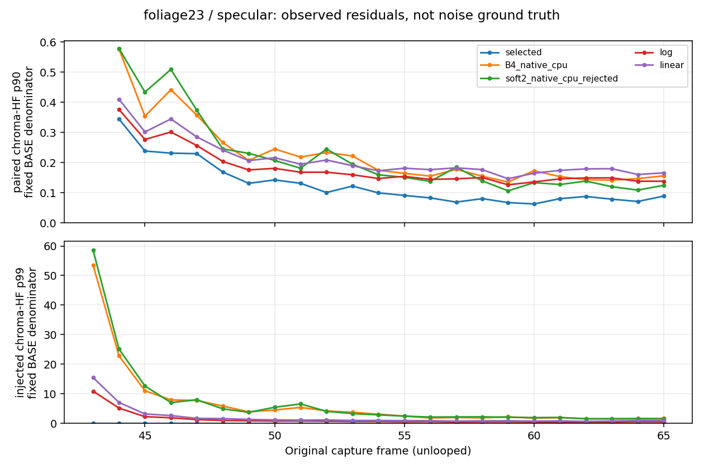

# Native colour: reproducible negative result and integration contract

## Decision

**Keep as research. Reject this frozen candidate for production image quality.**
The work delivers a real per-lobe CPU implementation, a linear competitor,
packed-word shader proposal, an exact job 08 adapter specification, independent
falsification tools, chronological measurements, plots, hashes and precise
local requests. It does **not** establish a fix for the user's pink trail.

The candidate preserves original selected RGBA words on protected pixels and
every alpha word in the executed CPU tests. It also avoids the old coarse-cell
leakage on tested large colour discontinuities. Nevertheless, it increases
temporal chroma noise, corrects less persistent bias than B4, and leaks across
subtle same-guide colour boundaries. A further covariance-confidence experiment
reduces noise partly by losing useful response, so it is also rejected.

No production file, packaged reference, baseline fixture, preset or generated
shader bytecode was changed. All work is in this candidate directory. The
eventual PR targets `sol/26-integration`; no merge or auto-merge is requested.

## Provenance and executable scope

| Item | Actual scope |
|---|---|
| Research tag | `astra-handoff-20261020` |
| Annotated tag object | `1f18416f5b99a0f78e147f362ac436ce2116ed22` |
| Resolved tag/base commit | `5d7839a930106cf8fe1ba8dbbc6750509e7f26a8` |
| Audited production commit | `87e8b7ab2a428bd91d3c044decf7d4dbccd8cefd` |
| Local branch | `astra/03-native-colour`, created from the tag |
| Runtime | Python 3.12.14, NumPy 2.3.5; optional figures Matplotlib 3.10.8 |
| Core SHA256 | `b75342a7eae8c3942849b9d1e469b89afeff5f600a9467045364b38fc20ca813` |
| GPU execution / DXC compilation / AMD RR execution | None in this job |
| Actual native ON routing / game observation | Not executed |

The tag was resolved through GitHub's tag object, cloned and checked out. Its
commit differs from the production baseline because it contains the handoff.
The initial `validate_package.py` verified **91 frozen files and 141 safe NPZ
arrays**. The original `run_cpu.py` passed all four suites in **5.430 seconds**
(outer wall 5.458). Those outputs were saved before candidate edits in
[baseline log](evidence/cpu_baseline.txt) and
[baseline receipt](evidence/baseline_runs.json).

These passing baseline tests intentionally reproduce existing defects; they do
not approve B4, native Anchor or rejected soft2 as final image-quality solutions.
Stored GPU comparisons remain historical calibration evidence. The new results
here are CPU arithmetic, synthetic interventions and measurements of recorded
arrays. They are not fresh AMD or game outputs.

The final verification separately passed the same four portable suites and
**24 new CPU contract/mutation tests**: 15 implementation tests and nine
independently authored tests. Exact commands, exits, timings and hashes are in
[root verification](evidence/root_verification.json). The independent quality
command returned **exit 1**; that failure is retained, not converted into a
successful quality result by the contract runner.

## Data inventory: what was actually available

[inventory.py](inventory.py) verifies the original archive and raw-array hashes,
uses `allow_pickle=False`, reports formats/units, zero/tail mass, exact selected
coverage, guide differences and origin-aware observed correlations. Its complete
output is [inventory.json](evidence/inventory.json).

| Clip | Original frames | Crop W×H | Original full render | Limits |
|---|---|---|---|---|
| Bottle | 180–186 | 128×256 | 1505×847 | Moving crop; bottle mask also includes hand/arm |
| Foliage | 43–65 | 192×64 | 1505×847 | Fixed band with multiple depth/coverage layers |
| Facade | 34–49 | 96×96 | 1505×847 | Small tile, not the original entire calibrated ROI |

Each clip retains original FP16 RGBA input D/S, raw RR D/S and selected RR D/S;
float32 signed depth; FP16 motion; packed uint32 original/provider normal and
roughness; 46 uint32 provider-control words; camera words, frame IDs and crop
origins. Albedo and final game output are absent. Raw/selected RR already have
pre-window history that this export cannot reconstruct.

The bottle crop origin changes from `(688,160)` to `(688,560)` in render pixels.
It is not object/camera motion. Previous local sample coordinates are computed
as `current_local + current_render_origin + motion_RG*original_render_extent -
previous_render_origin`. The average all-pixel in-bounds fraction after the first
frame is about 74.75% for bottle, 97.57% for foliage and 97.86% for facade.
The first frame has no prior image, and outside-crop history is never clamped
into a fabricated measurement. Reported observed correlation is not a claim of
independent Monte Carlo noise or correct dynamic-surface correspondence.

The colour frame63 witness is a 512×512 **D+S pre-remod sum** with prior history
warmed on CPU through frames0–62. Its C8 state must not be fed to B4. Some
original pre-UAV guide bits are missing, and the stored soft2 expectation cannot
be reproduced bit-exact from rounded RR RGB. The original precision caveat and
ideal portable sampler were retained.

The glass subset stores camera-aligned float32 RGB plus selected XOR and useful
geometry provenance, but lacks the full original noisy native RGBA inputs and
alpha contract for this pass. It was inventoried and its packaged test executed;
it was not silently reinterpreted as an equivalent native-colour sequence.
Anchor's stored grids likewise calibrate an estimator, not a new history replay.

### Why tail semantics matter

| Native input role | Zero RGB fraction | Energy in brightest 1% |
|---|---:|---:|
| Bottle diffuse | 23.40% | 36.56% |
| Bottle specular | 20.74% | 34.30% |
| Foliage diffuse | 35.66% | 32.99% |
| Foliage specular | 37.88% | 53.34% |
| Facade diffuse | 14.51% | 23.57% |
| Facade specular | 15.19% | 30.67% |

These are observed distributions, not labels saying which samples are noise.
A zero input can be a stochastic missing sample. A bright coloured sample can
carry legitimate expected radiance. Discarding either without a justified model
changes the target. All original material codes in these exported clips are
zero; they cannot identify semantic glass, foliage or a colour boundary.

## Falsifiers and independent work

Three agents had separate ownership: mechanism/representation experiments;
CPU/shader implementation and contract tests; independent skeptical review.
The reviewer froze seeds **104729, 130363, 155921**, phases and thresholds
before candidate inspection. Development used **17, 41, 73**. The core and its
parameters remained unchanged throughout held-out scoring and the follow-up.

The reviewer first ran the untouched `compare.py --quality-gate`. It returned
the expected **1**, with **6/32** edge cases worse for soft2. At phase4:

| Boundary | B4 unchanged-side contamination | Soft2 | Regression |
|---|---:|---:|---:|
| Depth | 0.05717988 | 0.09770542 | +70.87% |
| Normal | 0.05717988 | 0.09826054 | +71.84% |

This receipt predates candidate inspection and is preserved in
[known_bad_receipt.json](review/known_bad_receipt.json). It is a new CPU
reproduction, not a rerun of the historical GPU cases.

The hypotheses were kept separable:

1. **Representation alone stabilizes gains.** Falsifier: hold averaging,
   support, inverse and clipping fixed; a log reparameterization should not
   change the mathematical result.
2. **Robust per-sample log chroma removes harmful outliers.** Falsifier:
   mean-preserving rare coloured radiance must remain in the target; lower
   variance with biased colour is a failure.
3. **Upsampling is the entire boundary problem.** Falsifier: dirty target plus
   oracle reconstruction must still fail when the target discarded the edge.
4. **Pre-aggregation support and continuous confidence solve the trade-off.**
   Falsifier: equal-Y phase/angle sweeps, narrow lines, independent/AR/sparse
   noise and true changes must retain useful correction without extra grain.
5. **Wrong native pixels/domains cause the result.** Falsifier: independent
   per-lobe bit oracles, native-alpha-zero ON canary, D/S cancellation trap and
   exact selected-versus-raw gating must detect domain/authority mistakes.

Frozen definitions and full reasoning are in
[MECHANISM.md](mechanism/MECHANISM.md),
[review protocol](review/frozen_protocol.json) and
[independent review](review/REVIEW.md).

## Implemented candidate and preservation property

[native_colour.py](native_colour.py) implements a stateless current-frame
per-lobe CPU model. The default is **OFF**. A 7×7 full-resolution support uses
original depth, decoded normal, roughness and raw-RR log-opponent chroma **before
forming physical linear RGB means**. Compact weights vanish continuously at
their support limits; missing crop taps are omitted, not duplicated.

Both source and RR means use the same weights. Valid zero source samples stay
in the denominator. Negative/nonfinite observations or invalid geometry are
unsupported; affected current pixels retain selected output. No raw-pixel dark
mask, coarse gain texture or gain upsampler is added.

Let `c=RGB/Y`, with Rec.709 weights `L=(.2126,.7152,.0722)`, and dimensionless
`e=1e-4`. The representation is

`u=log((cR+e)/(cG+e)), v=log((cB+e)/(cG+e))`.

For a valid encoded colour, its analytic inverse uses
`r=(exp(u),1,exp(v))`, `c=(1+e)*r/dot(L,r)-e`, and `RGB=Y*c`.
The normalized epsilon gives positive-scale invariance in exact arithmetic;
zero/very-dark storage precision is still a separate issue.

The primary applies a bounded difference between source/RR mean opponents,
clipped to `±log(1.25)`, as multiplicative R/B gains with G as reference. It then
restores the original RR pixel's luminance before storage. This transports
pointwise luminance/detail and preserves genuinely zero raw RGB channels; it
cannot create a missing channel. The linear competitor transports an additive
normalized-RGB difference using identical support. Its clamp coordinates differ,
so identical preset strength does not mean identical achieved correction.

Confidence is `(Neff-1)/(Neff-1+4)`, with `Neff=(sum(w))²/sum(w²)` and a zero
floor. This is effective **spatial support**, not a calibrated confidence in
temporally correlated radiance. No history exists; reset, frame, motion and
crop metadata cannot manufacture one. This avoids adding temporal lag but also
removes the variance reduction a valid temporal estimator could supply.

Before arithmetic, eligibility is computed from **all four original RGBA
storage words**, independently per lobe, then intersected with explicit boolean
authority and active extent. Output starts as a selected copy. Only supported,
eligible RGB is written; alpha is copied as words. One-ULP RGB differences,
alpha-only differences, signed zero and NaN alpha payloads are protected.

The exact physical preservation statement is: protected original selected RGBA
and all selected alpha words are unchanged in the CPU model. Pointwise
luminance closure is pre-store in a single physical lobe; it does not prove
post-FP16-store equality or final remodulated composite equality.

## Mechanism results

### Log after the mean is not intrinsic denoising

With identical mean/support/clamp/inverse, matched log and normalized-ratio
application agree to maximum **2.27e-13** in float64 across 10,000 HDR pairs over
ten exposure decades. Float32 maximum discrepancy normalized by immutable raw
luma is **3.09e-6**. This is an algebra/precision check, not the primary
log-versus-additive competitor's quality comparison.

### Quiet robust colour can be wrong

In a controlled unbiased coloured-tail distribution, the rare component carries
25.20% of expected luminance. A robust per-sample log target has persistent
normalized-chroma RMSE **0.571534** and zero adjacent-window fluctuation. The
arithmetic target improves as sample support grows:

| Samples | Arithmetic RMSE | Robust log RMSE |
|---:|---:|---:|
| 64 | 0.309203 | 0.571534 |
| 256 | 0.148335 | 0.571534 |
| 4096 | 0.039605 | 0.571534 |

Under explicitly biased contamination, the roles reverse: arithmetic population
error is 0.334255 and robust error approximately zero. The observation model
decides whether rejection is justified. These competing outcomes are precisely
why the capture alone cannot authorize a universal robust target.

### Target mixing and reconstruction leakage are independently sufficient

With immutable unchanged-side masks and equal-Y colours, clean target plus dirty
reconstruction has maximum normalized contamination **0.128349**. Dirty target
plus ideal region-assigned reconstruction reaches **0.538152**. The latter uses
an oracle only to isolate the cause, not as an implementable hidden input.
Aligned phase0 conceals target mixing; shifted phases1–3 expose it.


All 36 finite-sample comparisons, population controls, precision checks and
phase results are in [mechanism/results.json](mechanism/results.json).

## Independent synthetic quality results

The held-out suite contains **640 static boundary cases, 144 thin-feature cases,
128 moving-boundary frames and 24 unlooped 24-frame noisy sequences**. It covers
both lobe levels, red/blue and green/magenta equal-Y edges, normal-only,
depth-only, roughness and same-guide edges, five angles, eight phases,
independent noise, coloured outliers, AR correlation, zero mass, steps and
flashes. B4/soft2 are unmodified RGB CPU controls behind the same proposed
native word gate; this adaptation is not an existing production native path.

Large-contrast clean cases have **zero unchanged-side contamination** for the
new methods. Log median static correction is 90.64%, and thin-feature
correction is 74.33%; this was not an all-identity cheat. However, the noise and
correction trade-off fails:

| Across 24 sequences | B4 | Log | Linear |
|---|---:|---:|---:|
| Median temporal chroma-HF p90 / B4 | 1.000× | **2.767×** | **3.168×** |
| Worst temporal chroma-HF p90 / B4 | 1.000× | **4.609×** | **5.534×** |
| Median low-band bias correction | 95.46% | **65.42%** | **76.99%** |
| Worst chroma RMSE | 0.03655 | **0.11730** | **0.13627** |
| Worst sparkle error p99.9 | 0.27759 | **0.42161** | **0.60913** |

Noise is greater even though correction is weaker. No equal-strength superiority
is claimed. The diffuse step response is **0.898051**, below the frozen 0.90
requirement within four frames; specular is 0.903331. The narrow formal failure
is retained without rounding up. The much larger grain regressions separately
justify rejecting deployment. Main independent run: **51.544 seconds, exit 1**.

The frozen synthetic temporal metric uses a four-pixel BASE interior on finite
32×48 analytic images. Its sigma1.5 high-pass filter reaches five pixels;
candidate plus metric support would require eight pixels to isolate the crop
boundary fully. The fixed synthetic results describe these finite scenes and
shared masks. They do not claim full-support isolation, and the later recorded
clip halo12 amendment does not retroactively change this held-out protocol.


### Additional small-contrast counterexample

The initial palette jumps can drive compact colour support all the way to zero.
To test a concrete remaining risk, the reviewer froze a separate follow-up with
opponent gap **0.12804** inside the fixed radius0.35, identical depth/normal/
roughness, left-only correction and unchanged right target. Eight phases,
0°/27° angles and two lobes produce **32/32 failures** beyond the original
FP16 envelope. Original held-out results and thresholds were left unchanged.

| Method | Maximum normalized unchanged-right contamination |
|---|---:|
| B4 | 0.0854353 |
| Soft2 | 0.0870627 |
| Log | **0.0626526** |
| Linear | **0.0630508** |

This is RGB L1 change divided by original raw luma, **not a luminance increase**.
Full-resolution support avoids discarded coarse edges only if its observed
guide separates the samples. Subtle same-guide material/lighting changes still
mix before reconstruction. Receipt:
[low_contrast_results.json](review/low_contrast_results.json).

## Covariance confidence: final competing mechanism

An untuned development-only ablation kept the same support and radiance mean,
including zero and tail samples. It estimated the complete paired source/RR
RGB covariance, propagated it through exact opponent Jacobians, and multiplied
correction by `q=||delta||²/(||delta||²+trace(Cov(delta)))`.

The frozen joint requirement was at least 20% null-HF reduction and at least
90% retention of both persistent-bias and true-change useful correction.

| Median development outcome | Moderate noise | Sparse coloured tail |
|---|---:|---:|
| Null temporal-HF reduction | 13.15% | 42.63% |
| Persistent-bias correction retained | 91.52% | 78.22% |
| Original true-change dose | 0.905393 | −0.049295 |
| Confidence-probe true-change dose | 0.781463 | −0.175216 |
| Joint frozen gate | Fail | Fail |

Four of six sparse original cases already have nonpositive useful dose; all six
probe cases point opposite the desired true change. A single retention
percentage would obscure that failure. Paired source=RR covariance cancellation
and exact output-word identity pass. Local independence, finite-sample
covariance, delta-method and RR-conditioned-support assumptions remain limits.
This diagnostic was not added to the shader or tuned on review seeds.

The initial aggregator errored on undefined retention ratios. That exit1 is
preserved in [harness correction](mechanism/confidence_harness_corrections.json).
Only reporting was repaired: nulls remain null and fail useful-dose acceptance.
No input, estimator or threshold changed. The full rerun returned exit0 in
10.458 seconds, with both quality strata rejected. See
[CONFIDENCE_RESULT.md](mechanism/CONFIDENCE_RESULT.md).

## Chronological recorded-clip measurements

[evaluate_clips.py](evaluate_clips.py) applies CPU post-selection models to the
original separate lobes once, in original frame order. Source/RR are physical
linear signals, not the game's final composite. B4 and soft2 start fresh CPU
state and receive motion scaled by the original render plus crop-origin delta.
They do not inherit fabricated pre-window history. The primary has no history.

Masks are derived once from finite original raw/selected RGB and valid original
depth, with exact original RGBA equality splitting eligible/protected pixels.
The denominator is `max(original raw Y,1e-6)`, independent of candidate output.
Temporal residuals use origin-aware ideal CPU bilinear pairing, require the
previous subset and original depth/normal agreement, and exclude the first
frame and unavailable previous samples. The sqrt2 factor is a residual-scaling
convention; correlation means it is not calibrated noise variance.

The final table reports **observed temporal chroma-HF p90 on eligible support**.
It is neither truth error nor directly comparable to the synthetic suite's
numbers, but it can expose added instability on fixed support:

| Clip/lobe | Original selected | Log candidate | Change |
|---|---:|---:|---:|
| Bottle diffuse | 0.073030 | 0.142849 | **+95.60%** |
| Bottle specular | 0.076343 | 0.161678 | **+111.78%** |
| Foliage diffuse | 0.095977 | 0.162440 | **+69.25%** |
| Foliage specular | 0.115990 | 0.169041 | **+45.74%** |
| Facade diffuse | 0.040941 | 0.136381 | **+233.12%** |
| Facade specular | 0.038620 | 0.126337 | **+227.13%** |

The low-band input-proxy distance decreases, while temporal chroma residuals
increase in all six rows. That is the relevant trade-off: moving toward a noisy
input colour proxy is insufficient evidence of useful trail correction. Linear
is still noisier. Per-frame sparkle/correction tails, spatial detail-energy
ratios, luma errors, per-lobe support counts and both protected/eligible
neighborhood metrics remain in [clip_results.json](evidence/clip_results.json).
Detail-energy is not a ground-truth detail score; added noise can increase it.



### Measurement amendment retained openly

An implementation-agent audit found that the initial three-pixel metric halo
covered the candidate's radius but not the metric filters. Chroma-HF uses
radius6, detail radius5, and the widest low-band proxy radius9. Candidate plus
metric support therefore needs **12 pixels**. The final scores use a common
12-pixel BASE halo for every variant; original halo3 scores and their protocol
are preserved in [initial results](evidence/clip_results_initial_halo3.json).
The source, parameters, frames and denominators did not change.

The original scores were already negative. This correction was prompted by an
independent support audit, not selected to obtain a favorable result. The
[amendment](evidence/measurement_audit.json) records both scopes. B4/soft2 reach
farther than the primary; their crop-limited spatial/history results are still
counterfactual controls. A full-support soft2+metric halo could leave no interior
in a 64-pixel-high foliage crop. They are not labelled complete native baselines.

Halo12 eligible sample counts remain substantial: bottle D/S 168896/168807,
foliage 154560/154466, facade 82186/82186 across their frames. Full-crop word
checks are not reduced to that halo. Across **1,318,912 lobe-pixels per new
variant**, every alpha word is unchanged. All **11,432 protected RGBA word
comparisons** per variant pass. These counts include exact differences beyond
the smaller quality region and correspond to 2,858 protected lobe-pixels.

Protected-subset high-pass values may change because their convolution sees
changed eligible neighbors. Such a neighborhood statistic does not imply a
changed protected pixel; the direct word oracle is the preservation authority.

### Precision is not a universal relative-luma guarantee

The model restores each eligible pixel's luma before half storage. Explicit
RTZ RGB storage can still change luma. The approximate absolute bound for
nonnegative RGB is `2^-10*Y + 2^-24`, plus float32 arithmetic error. Relative
error can be appreciable near half-subnormal values.

The retained initial receipt reaches 5.53012% relative to the frozen
`max(rawY,1e-6)` denominator in dark diffuse samples, and about 4.693% in
specular. An independent concrete check on foliage diffuse frame43 at local
`(x=131,y=41)` gives original Y `2.9986384e-6`, absolute stored-Y error
`4.2867669e-8` and relative error **1.42957%**, within the absolute RTZ envelope
`6.2533005e-8`. This is a real precision change, not an excuse to add the rejected
raw-dark guard. Final JSON also reports physical absolute errors. No blanket
“exact after store” or “always below0.1%” claim is made.

## Source-shaped shader, native ordering and cost

[NativeColourPacked.hlsl](shaders/NativeColourPacked.hlsl) is a concrete
source-shaped proposal. DXC was unavailable, so there is no compiled CSO or
claimed shader/GPU parity. Proposed entry `CSMain`, target `cs_6_2`, audited
DXC1.8 flags `-HV 2021 -Ges -Gis -O3`; native16 arithmetic is not enabled.
FP32 means, transforms and gain arithmetic feed explicit RTZ half packing.

The shader uses original packed half words through raw buffers, preserving
alpha by integer repacking. A typed float4 half load/store is not a universal
NaN-payload/signed-zero preservation proof. The conservative staging vehicle
has three texture-to-buffer copies, one selected-buffer initialization copy,
one compute and one buffer-to-owned-texture copy **per lobe**.

Unpadded incremental layout is 80 bytes/allocated pixel for D+S, or 112 with
FP32 diagnostic UAVs. At2560×1440, these analytic amounts are281.25MiB and
393.75MiB before alignment/descriptors/retained-flight copies. There are two
49-tap compute dispatches and ten copy operations. These are layout estimates,
not measured GPU milliseconds, allocations or resident VRAM. The proposal is
deliberately expensive and not performance-ready.

[INTEGRATION_SPEC.md](adapter/INTEGRATION_SPEC.md) gives the exact permitted
adapter specification instead of modifying production. The source ordering
was read from the immutable `FSRDNrdBridgeRR_Dx12.cpp` and
`FSRDNrdFlatAlbedoRecovery_Dx12.h` call sites:

1. Prepare every fallible allocation/descriptor/owner before provider recording,
   after the existing selected output pair is known.
2. Record only after provider normalization is restored, lobe recovery is
   recorded, and FlatAlbedo output selection has completed.
3. Keep the original selected/raw inputs immutable while making the word mask.
4. Update both `recorded->selectedSpec/Diff` and
   `Context::SetCommitInputs` SRVs before output publication/`CommitOwned`.
5. Retain original and new resource owners, heaps and constants through the
   exact recording fence; preserve generation/list/ticket and shared-budget
   checks. The guarded title commit gains no new allocation failure point.

Descriptor order is specular then diffuse. The raw slot remains raw; snapshots
and commit must agree on the new selected pair. A disconnected hook that
changes only pointers or only SRVs is not integration. Existing combined
ColourTrack's alpha authority and alpha1 store cannot be bound to native lobes.

No host feature was added. The future adapter would be default-off with zero
extra work when off. Preserve D16/S256, G2/G3, RR Fallback, Diffuse RR,
Reflection History and the existing NZR Temporal-off configuration. The current
quality rejection is not waived by an eventual successful native ON canary.

## Exact reproduction

From the repository root, using Python3.11+:

```sh
python -m pip install -r research/astra20261020/candidates/03-native-colour/requirements.txt
python -B research/astra20261020/candidates/03-native-colour/verify_bundle.py
python -B research/astra20261020/candidates/03-native-colour/run_checks.py
```

The single check command revalidates the frozen package, runs all four portable
suites and24 new contract/mutation tests, verifies the independent evidence
manifest/source hashes, reads candidate NPZ without pickle and reports the
retained quality rejection. **Its exit0 denotes execution/integrity, not quality
acceptance.** It does not overwrite independent experiment receipts.

The full scientific experiments are also independently runnable:

```sh
python -B research/astra20261020/candidates/03-native-colour/inventory.py
python -B research/astra20261020/candidates/03-native-colour/mechanism/experiment.py
python -B research/astra20261020/candidates/03-native-colour/mechanism/confidence_probe.py
python -B research/astra20261020/candidates/03-native-colour/review/reproduce_known_bad.py
python -B research/astra20261020/candidates/03-native-colour/review/run_review.py --quality-gate
python -B research/astra20261020/candidates/03-native-colour/review/low_contrast_probe.py
python -B research/astra20261020/candidates/03-native-colour/evaluate_clips.py
```

The main review quality command intentionally exits1 for this frozen candidate.
Scripts write their own evidence files; run them on a working copy if retaining
the original reviewer manifest is required. Timings may change on another CPU;
the recorded source, seeds, generated inputs, formulas and numeric outcomes
are the reproducibility contract. No external game/capture loader is needed.

Optional figure reproduction:

```sh
python -m pip install -r research/astra20261020/candidates/03-native-colour/requirements-figures.txt
python -B research/astra20261020/candidates/03-native-colour/mechanism/plot_results.py
python -B research/astra20261020/candidates/03-native-colour/mechanism/plot_confidence.py
python -B research/astra20261020/candidates/03-native-colour/evaluate_clips.py --plots
```

All panel columns share crop, frame, aspect and BASE exposure. The figures were
visually inspected. They depict synthetic truth or physical pre-remod CPU
outputs as labelled, never a fabricated final-game comparison.

## What the local requests resolve

[GPU_REQUEST.json](GPU_REQUEST.json) specifies the packed pass, formats,
constants, odd active/allocation extents, ON and mutation canaries, exact
protected-word tolerances, all-phase and low-contrast cases, normalization,
selected/SRV ownership, D3D debug checks and separate copy/compute/provider
timing scopes. Unknown hardware, actual allocation and compiler results are
explicitly null. Fresh AMD/game work would be a local gate, not an inferred
continuation of CPU execution.

[BLOCKED_DATA_REQUEST.json](BLOCKED_DATA_REQUEST.json) requests two surgical
observations for further research: a198×70 halo crop over original87ee
frames43–65 with matched native stages/final-output mapping, and independent
same-pose D/S samples with a converged reference to identify tail semantics.
It specifies raw formats/units, chronology, provenance, exact missing fields,
competing outcomes and maximum useful payload estimates. It does not ask for
all captures or pretend same-pose replay exists if the local setup cannot do it.

Missing final/albedo/truth observations limit future identification. They do
not erase the failures already proved by synthetic truth and fixed-support
counterexamples. The useful delivered result is a safer, calibrated benchmark
and a bit-preserving experimental interface, together with an explicit reason
to avoid deploying this candidate.

## Primary sources and evidence map

- Immutable handoff: [START_HERE](../../START_HERE.md),
  [COMMON_PROTOCOL](../../COMMON_PROTOCOL.md),
  [RETURN_PROTOCOL](../../RETURN_PROTOCOL.md),
  [DATA_CONTRACT](../../DATA_CONTRACT.md), [FINDINGS](../../FINDINGS.md),
  [task03 prompt](../../prompts/03-native-colour.md).
- Preserved math and provenance: [portable colour](../../portable/colour/README.md),
  [colour source](../../portable/colour/colour_portable.py),
  [colour comparison](../../portable/colour/compare.py),
  [clip contract](../../fixtures/clips/README.md),
  [glass contract](../../fixtures/glass/README.md),
  [anchor contract](../../portable/anchor/README.md).
- Production source read at the tag: `FSRDColourTrackConstants.h`,
  `precompile/FSRDColourTrackStats.hlsl`, `FSRDColourTrackTrack.hlsl`,
  `FSRDColourTrackApply.hlsl`, `FSRDNrdBridgeRR_Dx12.cpp`,
  `FSRDNrdFlatAlbedoRecovery_Dx12.h`, under
  `OptiScaler/shaders/fsrd_preprocess/`.
- Complete machine-readable task summary: [RESULT.json](RESULT.json);
  independent assessment: [REVIEW.md](review/REVIEW.md);
  file integrity manifest: [SHA256SUMS.json](SHA256SUMS.json).
