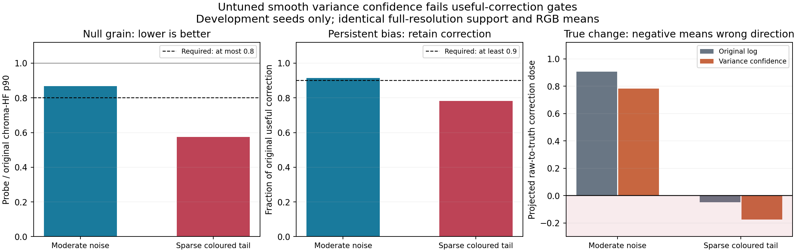

# Final variance-confidence probe: rejected without tuning

The final plausible low-band confidence mechanism was implemented separately
from the native candidate. It keeps the same full-resolution support, linear
RGB means, zeros, rare bright samples, log correction and selected-pixel
authority. It estimates all paired source/RR RGB covariance terms, propagates
them through the exact log-opponent Jacobian and applies the smooth factor
`q = squared_delta / (squared_delta + estimated_delta_variance)`.
[`CONFIDENCE_PROBE.md`](CONFIDENCE_PROBE.md) freezes the formulas, synthetic
scenes, parameters and success criteria before execution.

**Decision: reject this specific confidence rule as a proposed addition.**
Its lower noise does not retain the required useful correction. No parameter
search, amplitude renormalization, native source modification, shader addition
or reviewer-seed access was performed.

## Measured trade-off

[`confidence_results.json`](confidence_results.json) contains 36 development
cases: three frozen seeds, two physical lobe scales, two independent noise
distributions and three signal histories. Each case is 24 chronological frames
at 24x32; all metrics use the same predeclared interior mask. The two lobe
scales reuse identical synthetic factors and are not independent captures.

| Quantity, median across development cases | Moderate noise | Sparse coloured tail |
|---|---:|---:|
| Null temporal chroma-HF p90, probe/original | 0.868505 | 0.573674 |
| Null chroma-HF reduction | 13.15% | 42.63% |
| Persistent-bias correction dose retained | 91.52% | 78.22% |
| True-change dose, original log | 0.905393 | -0.049295 |
| True-change dose, variance confidence | 0.781463 | -0.175216 |
| True-change dose retained where meaningful | 86.25% | Original dose is nonpositive in 4/6 cases |
| Frozen development gate | **Fail** | **Fail** |

The gate required at least 20% null HF reduction and at least 90% retention of
both persistent-bias and true-change correction, in every case in the stratum.
Moderate noise fails the HF and true-change requirements. The sparse case
loses too much persistent correction, and the response to a true colour change
is worse than mere attenuation: **all six probe cases move opposite the true
desired direction**. The original candidate already moved opposite that
direction in four cases. The two remaining original positive doses were very
small and became negative with the probe, so dividing their values produces
large negative ratios; those ratios are not a meaningful quality percentage.

Correction dose is the projection of the applied opponent-colour change onto
the analytically desired raw-to-truth direction, divided by that direction's
squared magnitude, summed over the same fixed pixels and frames. One is full
desired correction, zero is no correction, and negative is correction in the
wrong direction. For the true-change case, raw RR follows an explicitly
synthetic 20%-per-frame response; it is not an AMD RR measurement.



## Why the negative result is informative

The covariance mechanism does retain zeros and tail radiance in the target
mean. It therefore avoids the explicit rare-sample rejection bias demonstrated
by the earlier robust-log control. It still relies on a finite, noisy mean and
uses the same observation both to decide the correction's direction and to
estimate confidence. Sparse chromatic observations, clipping and nonlinear
normalization can make that data-dependent attenuation asymmetric. The observed
wrong-direction true-change result rejects a simple claim that estimated
uncertainty alone repairs these effects.

Under moderate null noise, mean `q` is roughly 0.4, yet spatially filtered
temporal chroma-HF falls only about 13%. A large attenuation of average
correction amplitude does not imply the same improvement in fine chroma grain.
This is another reason to measure the user's grain and response concerns
directly rather than accepting a confidence map as a quality result.

This experiment does not prove that every possible variance estimator fails.
It falsifies one plainly specified, untuned candidate under its declared
synthetic conditions. Weighted effective sample size assumes independent
observations; source/RR-conditioned support, spatial correlations and large
sample tails can invalidate that covariance interpretation in real captures.
The delta method can also be inaccurate near a small channel mean. The real
inputs do not supply an independent estimate of that uncertainty or calibrated
final-colour truth.

## Correctness and execution record

The paired identity control supplied identical stochastic RGB to source and RR.
With cross-covariance included, estimated delta variance cancelled to a maximum
of **6.94e-18**, and output RGBA word differences were **zero**. All synthetic
alpha-word checks passed. No negative variance trace occurred in the 36
reported scenes; the implementation records and clamps a negative numerical
trace if one occurs in another run.

The first execution returned exit1 during summary aggregation because some
original true-change correction doses were nonpositive, making a retention
ratio undefined. [`confidence_harness_corrections.json`](confidence_harness_corrections.json)
preserves that failure. The repair keeps undefined ratios null, reports their
counts, and fails the useful-dose gate; it changes no estimator, data or
acceptance parameter. The subsequent complete execution returned **exit0 in
10.458 seconds** with NumPy 2.3.5. Exit0 means the experiment and its checks ran;
the measured quality verdict remains rejection.

```sh
python research/astra20261020/candidates/03-native-colour/mechanism/confidence_probe.py
python research/astra20261020/candidates/03-native-colour/mechanism/plot_confidence.py
```

The second command is optional and uses Matplotlib3.10.8. Native source and
frozen protocol hashes are recorded in the result. No GPU, fresh AMD RR,
production shader, timing, VRAM or game-output result is asserted.
