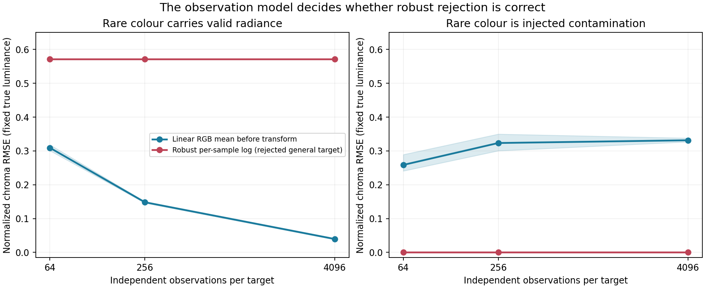
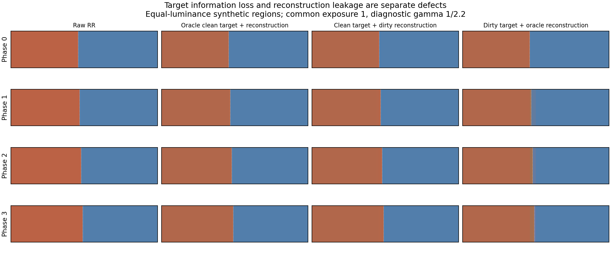
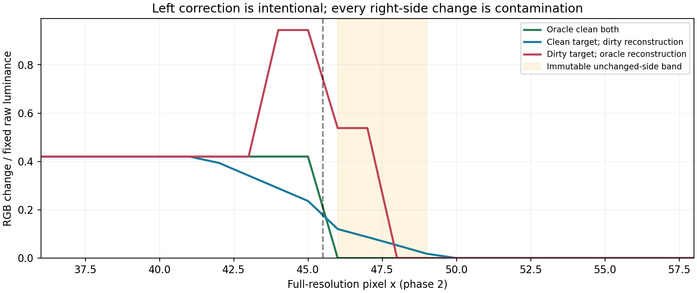

# Representation investigation: useful negative results

## Decision

Retain **physical linear RGB averaging before a bounded colour transform** as
the candidate's ordering. Reject per-sample robust log-chroma as a generally
unbiased radiance target. Also reject the claim that applying a logarithm after
the same RGB mean, then undoing it with a matched inverse, is itself a denoiser.
Boundary-aware support and explicit confidence remain separate candidate
mechanisms to test; this investigation does not establish their quality.

The executable evidence is [`results.json`](results.json), generated by
[`experiment.py`](experiment.py). [`MECHANISM.md`](MECHANISM.md) records the
falsifiers before these experiments and its SHA256 is included in the result.
The CPU executor was the mechanism subagent with NumPy 2.3.5. No GPU, AMD RR,
native host integration, performance timing, or final game display was run.

## 1. A quiet wrong estimator can look perfect to a noise metric

The first synthetic observation distribution consists of zero radiance with
probability 0.60, ordinary RGB `(0.20, 0.55, 0.12)` with probability 0.38 and rare
RGB `(12.0, 0.35, 0.60)` with probability 0.02. Its exact physical expectation
is `(0.316, 0.216, 0.0576)`. The rare class carries **25.20%** of expected
luminance. It is legitimate radiance by construction, not contamination.

With the immutable true-luminance denominator, the population chroma error of
the arithmetic RGB mean is zero. The population chroma RMSE of the robust
per-sample log median is **0.571534**. The latter has zero adjacent-window
fluctuation in this experiment because the ordinary colour remains the median
in every generated window. Its apparent absence of noise is a stable colour
bias.

| Independent samples per target | Arithmetic target chroma RMSE | Robust log target chroma RMSE | Arithmetic adjacent-window fluctuation | Robust adjacent-window fluctuation |
|---:|---:|---:|---:|---:|
| 64 | 0.309203 | 0.571534 | 0.535599 | 0 |
| 256 | 0.148335 | 0.571534 | 0.265922 | 0 |
| 4096 | 0.039605 | 0.571534 | 0.070735 | 0 |

These finite-support figures average the three frozen seeds `17, 41, 73`, with
192 windows per seed. Adjacent windows are independent synthetic realizations;
the fluctuation statistic is not a captured temporal sequence, motion test or
temporal high-frequency acceptance metric. Diffuse and specular runs use the
same generated samples at two stated scales to test scale invariance. They are
not independent captured-lobe observations.

The second generator instead defines the rare chromatic addition as biased
contamination. Its true colour is the ordinary population's colour. Here the
arithmetic target has a **0.334255** population error and the robust target is
correct to floating-point precision. Both examples are intentional: a robust
target can be appropriate when its contamination model is justified. A low
noise score cannot tell which model describes the real native inputs.



## 2. A matched log parameterization does not create a noise advantage

Under the same positive RGB means, same relative epsilon, same `[0.75, 1.33]`
gain clamp and pointwise luminance restore,

`clip(C_target / C_raw, lo, hi)`

and

`exp(clip(log(C_target) - log(C_raw), log(lo), log(hi)))`

are algebraically identical. This is a parameterization equivalence, not the
candidate's log-versus-additive-opponent ablation and not GPU parity.

The explicit 10,000-pair exposure sweep from `1e-7` to `1e3` measured:

| Check | Measured maximum |
|---|---:|
| Float64 output difference, ratio versus log | 2.27374e-13 |
| Float64 absolute lobe-luminance error | 2.27374e-13 |
| Float64 scale-invariance error | 2.22045e-16 |
| Float32 output difference / immutable raw luminance | 3.08784e-6 |
| Float32 absolute output difference over the HDR sweep | 1.22070e-4 |
| Identity difference | 0 |
| Robust constant-colour closure difference | 2.22045e-16 |

All four invalid classes—zero aggregate, negative physical channel, NaN and
Infinity—were explicitly rejected. Missing chroma observations do not become
per-pixel dark apply gates. The log form can still make bounded multiplicative
correction easier to express, but any real noise change must come from a
different statistic, support, clipping rule or temporal update. Smoothing log
coordinates across samples or time changes the estimator and requires another
truth test.

## 3. Mixed targets and dirty reconstruction are independently sufficient

A synthetic same-luminance red/blue boundary was shifted through every phase
of a four-pixel cell. A correction belongs only to the left side; every change
in the fixed four-pixel band on the right is contamination.

The **dirty-target / oracle-reconstruction** ablation gives the reconstruction
the correct region-specific raw mean and exact region assignment, without
interpolation. It intentionally retains only the mixed target. The
**clean-target / dirty-reconstruction** ablation has the exact region-specific
target and denominator, then averages/interpolates the resulting gains. Its
error is therefore confined to reconstruction. These oracle labels isolate a
cause; the native candidate cannot assume those labels are supplied.

| Cell phase | Oracle clean both | Clean target, dirty reconstruction | Dirty target, oracle reconstruction |
|---:|---:|---:|---:|
| 0 | 0 | 0.103763 | 0 |
| 1 | 0 | 0.095452 | 0.516544 |
| 2 | 0 | 0.120211 | 0.538152 |
| 3 | 0 | 0.128349 | 0.480006 |

Values are maximum RGB L1 change divided by the immutable raw lobe luminance
on the unchanged-side band. They are not B4/soft2 or candidate quality scores.
An aligned cell hides the target-mixing failure; an interpolating reconstructor
can still leak at that same alignment. Neither failure is repaired by merely
renaming the colour coordinates.





## 4. Recorded inputs make this distinction material but do not resolve it

The six diffuse/specular clip-role distributions have zero-luminance fractions
between **14.51% and 37.88%**. Samples at or above each role's 99th-percentile
luminance threshold carry **23.57% to 53.34%** of total observed luminance.
The largest fraction occurs in foliage23 input specular. Ties at the threshold
are reported as the actual retained pixel fraction. File hashes, frame IDs,
quantiles, negative counts and nonfinite counts are preserved in `results.json`.

Those observations show why discarding a small set of bright colour samples
can change the radiance target substantially. They do not prove whether each
bright sample represents correct lighting, stochastic variance, reuse bias or
an artifact. The parent report's more complete immutable-mask inventory and
chronological diagnostics remain authoritative.

## Reproduction

From the recorded handoff checkout:

```sh
python research/astra20261020/candidates/03-native-colour/mechanism/experiment.py
python research/astra20261020/candidates/03-native-colour/mechanism/plot_results.py
```

The first command requires NumPy only and returns nonzero if an asserted
mechanism/calibration check fails. The optional second command uses Matplotlib
(executed version 3.10.8), checks that the displayed ablation arrays reproduce
the JSON metrics, and regenerates all figures with the same crop/exposure.
The exported SVG is the scalable representation plot. The PNG panels were
visually inspected for clipping, readable labels, common transfer and aspect.
