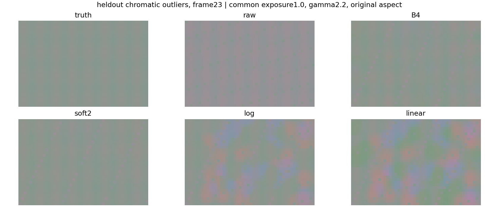
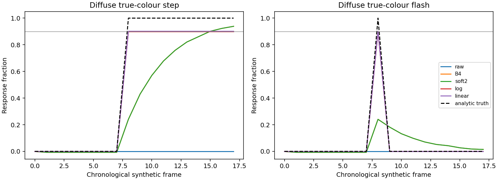

# Independent skeptical review: retain as research, reject production adoption

The frozen log candidate preserves the tested native byte contracts and avoids
the coarse-grid boundary failure on large chroma discontinuities. It is **not an
acceptable native colour fix**. Independent noisy sequences show substantial
grain/flicker growth; an additional low-contrast counterexample demonstrates
that its full-resolution support can still contaminate an unchanged material.
The benchmark, protection tests and negative results are useful research output.

This review applies to `native_colour.py` SHA-256
`b75342a7eae8c3942849b9d1e469b89afeff5f600a9467045364b38fc20ca813`.
The source and default configuration were not tuned during review. All new
measurements below are CPU executions. No GPU, AMD RR, native bridge, compiled
shader or final-game result is claimed.

## Independence and frozen evidence

The reviewer first read the handoff protocols, portable reference, tests,
provenance and recorded GPU receipts. Before inspecting candidate code or
candidate quality results, the reviewer froze seeds `104729`, `130363`,
`155921`, all eight phases, angles `0/27/45/73/90` degrees, per-lobe truth
metrics, word-preservation gates, 95% closure-detail retention and a 90%
true-colour-step response requirement within four frames. The candidate
development seeds `17/41/73` were excluded. See
[`frozen_protocol.json`](frozen_protocol.json).

The reviewer then ran the unmodified known-bad comparison before accepting
candidate results. `python -B compare.py --quality-gate`, from the packaged
portable colour directory, exited **1 as expected** in 2.610 seconds. Six of
32 phase cases worsened. At phase 4:

| Boundary | B4 right-side mean contamination | C8/soft2 | Soft2 / B4 |
|---|---:|---:|---:|
| Depth | 0.0571798794 | 0.0977054164 | 1.70874 |
| Normal | 0.0571798794 | 0.0982605442 | 1.71845 |

These are this review's **CPU** values, not re-executions of the separate
historical GPU numbers. The receipt preserves commands, expected/actual exit
codes, hashes and stdout in [`known_bad_receipt.json`](known_bad_receipt.json)
and [`known_bad_stdout.json`](known_bad_stdout.json). The reviewed frame-63
fixture remains a CPU-warmed prior state plus one recorded GPU-frame witness;
it has not become a temporal native validation.

## What was tested

The main quality run executed 640 clean phase/orientation/guide cases, 144
thin-feature cases, 128 chronological moving-boundary frames, and 24 independent
24-frame synthetic sequences. Both physical diffuse and specular lobes were
evaluated separately. Synthetic raw and source noise use separate RNG streams.
The source distributions include independent chromatic lognormal noise, rare
positive chromatic outliers, temporal AR noise with finite-startup variance,
and 84% achromatic dropout followed by chromatic variation. Their expected
linear RGB is analytically specified before generated FP16 input storage.

Every synthetic sequence is chronological, unlooped and starts with fresh
model state. The proposed candidate is stateless; the B4 and soft2 controls use
their original CPU histories. B4/soft2 remain the packaged RGB algorithms,
wrapped per lobe with the same original-word selection/authority mask solely
for this comparison. This wrapper is **not existing native production code**.

Masks come from original raw/selected/authority data. Temporal spatial support
uses the intersection of those original eligible masks and a fixed interior
border. The temporal luminance denominator is the original raw sequence's
mean luma, computed before any model. It is never reconstructed from a candidate.
Metrics subtract analytic truth chroma before extracting spatial high frequency,
so a real prescribed colour change does not count as noise. Grain, sparkle
tails, temporal differences, bias correction, luminance and detail are reported
separately in [`temporal_results.json`](temporal_results.json).

The controls have different achieved correction strengths. Consequently the
aggregate table below is a trade-off comparison, not proof that a log transform
improves noise at an equal correction dose. The mechanism investigation has a
separate matched-transform analysis. No post-review strength search was used to
alter these held-out results.

## Native protection and correctness

All nine independent adversarial correctness tests pass. They cover original
half and float32 words; selected-versus-raw RGB differences of one ULP; alpha-only
differences; signed zero; alpha NaN payloads; alpha zero with a demonstrably active
correction; missing/false authority; default and explicit OFF; inactive extents;
invalid geometry and negative RGB; input immutability; exposure scaling; and
the declared stateless reset/crop behaviour. All-alpha comparison is independent
of whether a pixel is eligible. Exact output comparisons use integer views,
never floating-point equality of NaNs or signed zero.

Two intentionally broken paths are caught: comparing selected with itself
instead of original raw RR makes the protected-pixel oracle fail; ignoring OFF
and forcing an enabled correction makes the OFF oracle fail. The 24 temporal
sequences additionally check 73,152 protected pixel-frames and all 884,736 alpha
words **per tested method**, with zero changes. These counts are coverage of
specific generated frames, not native-host/GPU coverage.

The first test invocation had one reviewer harness error: omitted authority
correctly raised `TypeError`, while the initial probe accepted only `ValueError`.
The fail-closed requirement does not prescribe a Python exception class. The
probe was corrected to accept either, with no candidate or quality-threshold
change; [`harness_corrections.json`](harness_corrections.json) retains this event.

The source-shaped shader correctly recognizes that a typed FP16 float4
load/store is insufficient evidence for arbitrary alpha-word preservation. Its
packed integer staging proposal is appropriate for a future exact-word test,
but this reviewer has not compiled or executed it. Descriptor/resource/lease
ordering, copy footprints, integer packing and final selected-pointer updates
still require actual local host validation.

## Boundary result: a real improvement with a decisive limitation

For the original high-contrast palette, the primary candidate adds exactly zero
unchanged-side RGB contamination in all 640 static, 144 thin and 128 moving
cases. Its median static bias correction is 90.64%, and median thin-feature
correction is 74.33%, so the result is not achieved by universal identity.
The smallest thin correction is 55.34%, exposing reduced sample support rather
than hiding it. Constant-colour closures with high-frequency chroma and luma
detail are word-identical for both new candidates; their detail contrast ratio
is 1.0 in both lobes. See [`boundary_results.json`](boundary_results.json) and
[`dynamics_results.json`](dynamics_results.json).

The moving-boundary control deliberately uses zero motion and fresh chronological
history. It witnesses an unmodelled/disoccluded boundary for the old temporal
controls; it does not establish how they perform with fully correct game motion
vectors. The stateless candidate makes no motion/history claim.

The original palette has large RR chroma jumps, which force the compact colour
weight to zero. After the primary run, the reviewer conducted one separately
specified follow-up, without parameter tuning or changes to the frozen quality
set. Its raw left/right colours have equal luminance and identical depth, normal
and roughness. The raw opponent gap is only 0.12804, inside the fixed guide radius
0.35. Only the left target changes; the right target equals the original right
raw words exactly. Eight phases and angles 0/27 degrees were tested per lobe.

**All 32 follow-up cases contaminate the unchanged right beyond the original
FP16 storage envelope.** Maximum primary-log contamination is 0.0626526, compared
with 0.0630508 for linear, 0.0854353 for B4 and 0.0870627 for soft2. This metric is
`sum(abs(output_RGB - original_raw_RGB)) / original_raw_luma`; it is a chromatic
change, not a claimed 6.3% luminance increase. The candidate's maximum excess over
the conservative storage envelope is 0.0577705. The original quality receipt and
native source hashes remain unchanged. See
[`low_contrast_probe_protocol.json`](low_contrast_probe_protocol.json) and
[`low_contrast_results.json`](low_contrast_results.json).

This failure distinguishes full-resolution sampling from truly reliable sample
membership: avoiding a mixed coarse cell preserves information, but a positive
support weight can still mix two different low-contrast materials or lighting
regions before the colour transform. An upsampler is not needed for this failure.


## Noise and correction trade-offs reject the candidate

The main held-out sequences show worse chroma high-frequency temporal p90 than
B4 in every new-candidate sequence. Ratios below are medians across the three
frozen seeds within each lobe/noise family; correction is the remaining
low-band-bias reduction relative to original raw.

| Lobe | Noise | Log HF p90 / B4 | Log bias correction | Log chroma RMSE | B4 chroma RMSE |
|---|---|---:|---:|---:|---:|
| Diffuse | Independent | 2.325 | 84.38% | 0.03123 | 0.00815 |
| Diffuse | Chromatic outliers | 3.357 | 51.12% | 0.11223 | 0.03160 |
| Diffuse | Temporal AR | 2.427 | 77.73% | 0.04220 | 0.01642 |
| Diffuse | Sparse | 4.218 | 54.13% | 0.09702 | 0.02247 |
| Specular | Independent | 2.311 | 85.82% | 0.03043 | 0.00739 |
| Specular | Chromatic outliers | 3.305 | 52.07% | 0.11216 | 0.03366 |
| Specular | Temporal AR | 2.444 | 84.50% | 0.03673 | 0.01257 |
| Specular | Sparse | 4.496 | 53.04% | 0.09770 | 0.02233 |

Across all 24 sequences, log's temporal-HF ratio has median 2.767 and worst
4.609. Linear is still noisier, with median 3.168 and worst 5.534, while correcting
more of the low-band bias: 76.99% median versus log's 65.42%. B4 corrects 95.46%.
The lower log noise does not resolve that dose trade-off. Log's worst sparkle
error p99.9 is 0.42161, versus 0.27759 for B4 and 0.60913 for linear. In the
outlier family, both new models can have higher chroma RMSE than doing no colour
correction at all, despite moving the mean towards the correct colour.

The unchanged pointwise detail closure does not cancel this failure: the
candidate transports noisy low-band gains onto otherwise cleaner RR. Its
support-count confidence is high when many zero samples are geometrically
valid; this is not evidence that a sparse physical colour expectation is known.
The full-resolution 7x7 stateless mean has less variance reduction than the old
large-footprint/history controls. A transform applied after that mean does not
recreate missing statistical support.



Temporal `luma_relative_error_max` is explicitly measured against analytic truth
in `run_review.py`; it includes generated half-input error. Direct output versus
selected per-lobe luma error is reported by the boundary metrics. Neither
measurement establishes luminance of the game's unknown remodulated composite.

## True changes and the formal frozen gate

The stateless log candidate responds immediately to a moderate true-colour
change and has no additional post-flash tail beyond its original half-storage
offset. Its diffuse response is 0.898051 and specular response 0.903331; those
values remain constant after a persistent step. The frozen 0.90-within-four-
frames requirement therefore fails for diffuse. The narrow margin is reported
as it was defined, without rounding it into a pass. This failure alone is not
the main reason for rejection; the large noise regression and low-contrast
counterexample are substantive quality failures independently.

B4's response by four frames is approximately 0.678, consistent with its slower
EMA, while its clean flash has a subsequent residual. These are controlled CPU
step/flash experiments, not observations of real game lighting or AMD RR.



## Reproduction and interpretation

From the repository root:

```sh
python -B research/astra20261020/candidates/03-native-colour/review/reproduce_known_bad.py
python -B research/astra20261020/candidates/03-native-colour/tests/test_adversarial.py -v
python -B research/astra20261020/candidates/03-native-colour/review/run_review.py --quality-gate
python -B research/astra20261020/candidates/03-native-colour/review/low_contrast_probe.py
python -B research/astra20261020/candidates/03-native-colour/review/render_low_contrast.py
```

The first wrapper returns 0 only when the unmodified soft2 subprocess returns
its expected rejection status 1. Correctness tests return 0. The third command
returns **1 for the new candidate's failed frozen quality gate**, and the report
retains that failure. The low-contrast follow-up returns 0 when the measurement
completed; inspect its explicit `counterexample_found:true`, not its process
success code, for the scientific result. Matplotlib is optional for the main
model measurements but required to regenerate PNG panels. Saved NPZ arrays
must be opened with `allow_pickle=False`.

`review_result.json` records the 51.544-second main CPU run, runtime versions,
source/protocol hashes and output hashes. Timing is CPU experiment wall time,
not shader performance. No production enablement or extra default-off game
deployment is recommended from this review. Preserve this code as a falsifier
and interface prototype. A replacement target/support mechanism must first
survive these retained failures, before local native-route, protected-word,
GPU-parity, fresh-RR and same-crop final-game acceptance are requested.
