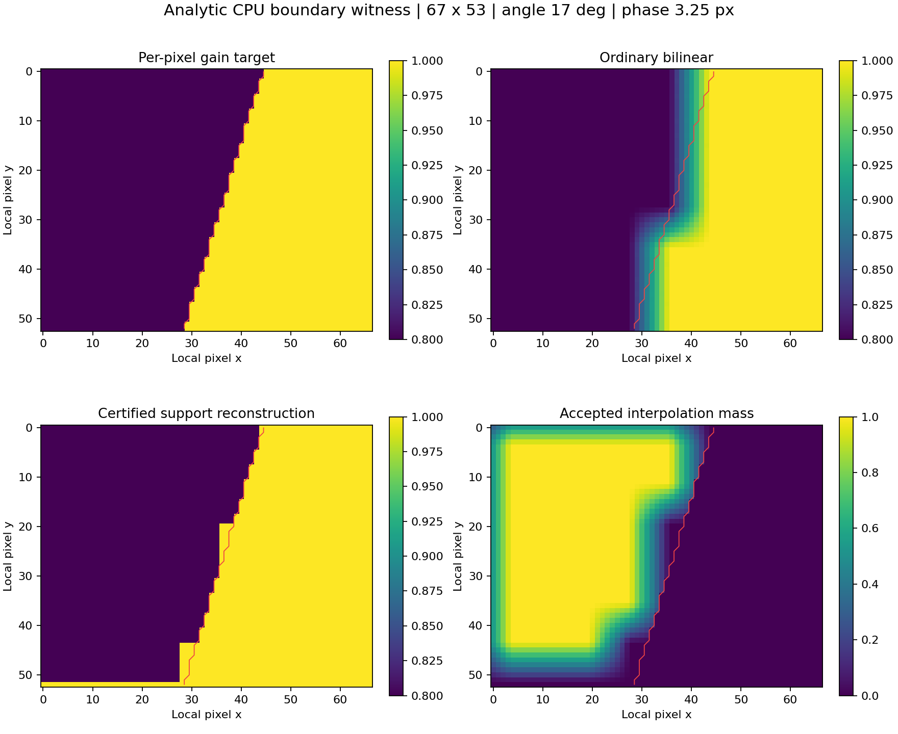
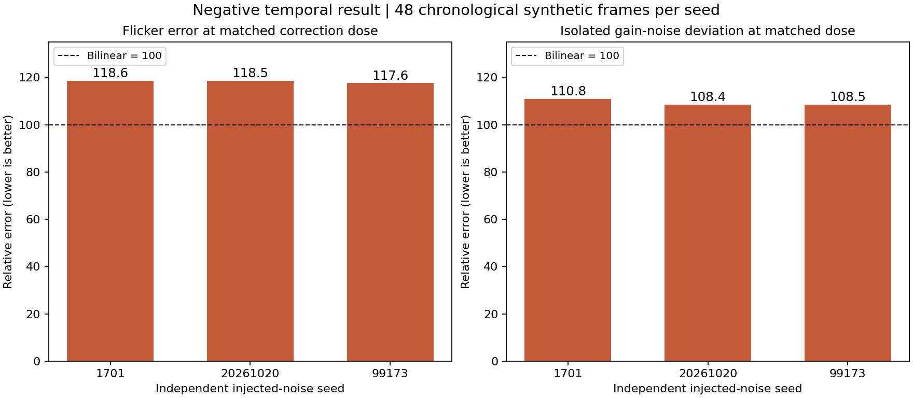

# Job04 — geometric transport and support-certified reconstruction

## Recommendation and scope

**Keep as research. Do not ship this reconstruction as a quality improvement.**

The CPU transport contract and diagnostics are reusable. Conditional geometric
support stops correction spilling onto protected pixels and retains substantially
more correction than whole-stencil rejection. However, its changing support
increases synthetic temporal error: at matched correction dose, eligible-pixel
flicker is **17.56–18.58% worse** than ordinary bilinear, and isolated gain-noise
deviation is **8.40–10.84% worse** over three deterministic seeds. No fresh GPU,
AMD RR, native bridge, DLL, performance or game-quality result is claimed.

This job changes only `research/astra20261020/candidates/04-geometry-transport/`.
Production files, packaged reference implementations and fixture bytes are
unchanged. Existing presets remain as supplied. The proposed HLSL is default-off
research source plus an exact host adapter specification; it has not been
compiled or installed. Job08 owns any later production integration.

| Revision | Identity |
| --- | --- |
| Immutable handoff tag | `astra-handoff-20261020` |
| Resolved handoff commit | `5d7839a930106cf8fe1ba8dbbc6750509e7f26a8` |
| Frozen production baseline | `87e8b7ab2a428bd91d3c044decf7d4dbccd8cefd` |
| Final executable research source revision | `cd4207f3dc2b886ec0136a246dd2484966bdbfec` |
| Task branch | `astra/04-geometry-transport` |
| PR target | `sol/26-integration` |

The final evidence/documentation commit follows the executable source revision.
Source hashes in `evidence/execution.json` identify the actual tested code. The
earlier source commit and failed oracle receipt remain available for audit.

## 1. Competing explanations and discriminating tests

| Hypothesis | Independent prediction | Result and scope |
| --- | --- | --- |
| Pixel-centre, jitter, UV or transform convention is wrong | Noise-free rigid geometry has a deterministic signed phase or scale error. | Confirmed as a **source arithmetic witness** for the extra half pixel; generic correct transport passes independent analytic pose oracles. Capture-quality causality remains unproved. |
| Coarse support mixes geometry | Thin/intersecting surfaces depend on cell phase even when homogeneous planes pass. | Observed in analytic scenes. Checking every observed source texel rejects hidden one-pixel mixtures that centre-only checks miss. Subpixel layers not represented by the observations remain unidentifiable. |
| Full-resolution reconstruction crosses an invalid boundary | A coarse moving-cell identity test passes while protected pixels still change. | Independently reproduced before candidate inspection: `[0.6,1]` gains produce maximum **0.175** spill and change **4/8** protected pixels. |
| Specular virtual motion differs from surface motion | Correct surface MVs still disagree with a reflected feature; a usable reflection distance predicts another endpoint. | Analytic planar mirror gives a **1.844634 px** difference and **1.6** parallax ratio. Recorded alpha is not certified as the required reflection-distance observation. |

Sources and actual graph edges are documented in
[COORDINATE_LEDGER.md](docs/COORDINATE_LEDGER.md) and
[MECHANISM_REVIEW.md](docs/MECHANISM_REVIEW.md). In particular, matrix memory
storage, row/column mathematical conventions, raster shifts, physical pixel
coordinates, active extents, allocations and moving crop origins are separate
named concepts. No matrix change was mixed into a statistical gain adjustment.

### Source-derived coordinate witnesses

Native and combined Stats measure cells around `8*c+4`. `ViewPosition` adds
another `0.5`, while `ProjectToPixels` returns pixel-edge coordinates. For the
identity transform, the source arithmetic therefore predicts **(+0.5,+0.5) px**,
or about **0.707107 px** Euclidean displacement. The baseline four-pixel static
threshold can hide this deterministic residual. This is not a fresh shader run.

The grid is `floor(W/8) x floor(H/8)`, while recall and shared Apply normalize it
across the full active extent. At `1505 x 847`, the grid is `188 x 105`. The last
coarse centres differ from physical eight-pixel centres by approximately
**0.99734 px horizontally and 6.96667 px vertically**, independently of the
extra half pixel. The requested GPU experiment isolates these two mechanisms.

Native key capture stores **absolute** depth. Its RH analytic control matches
272/272 samples; comparing signed stored depth with the native absolute expected
depth matches 0/272. Combined signed storage is labelled separately. The exact
native arithmetic also has a tiny-positive-depth corner where the tolerance
floor accepts stored zero; the clean generic support API rejects zero depth.

## 2. What data was actually available

The initial package check verified **91 frozen files and 141 safe NPZ arrays**.
Python 3.12.14 and the required NumPy 2.3.5 were already present. The unchanged
CPU entry point passed its four suites: anchor (7 unittest checks), colour (12),
clip integrity/provenance and glass calibration. These tests intentionally
reproduce known rejected behavior; passing them is not a visual approval.
See [baseline_execution.json](evidence/baseline_execution.json).

The inventory covers 11 NPZ archives, with archive and per-array SHA256, shapes,
dtypes and provenance in [fixture_diagnostics.json](evidence/fixture_diagnostics.json).
Every NPZ load uses `allow_pickle=False`.

| Dataset | Available chronology and representation | What it cannot establish |
| --- | --- | --- |
| Bottle | Frames180–186, 128x256 moving crop, original1505x847 render motion, per-frame origins, original typed D/S/depth/normal/motion and provider/camera words. | Missing pre-start history, albedo, converged shape/reference and raw anchor keys. |
| Foliage | Frames43–65, 192x64 fixed crop; multiple depth/coverage layers. | Semantic foliage identity, complete temporal history or full native replay. |
| Facade | Frames34–49, 96x96 crop. | The original whole-ROI quality benchmark or unseen exterior support. |
| Anchor | Already-recalled Stats/recalled/gain and immutable masks; seven recorded native-policy frames. | A new key selector, raw six-slice geometry support or native bridge execution. |
| Colour | Frame63 with CPU-warmed prior history0–62, recorded one-frame GPU outputs and original-render motion scaling. | Full GPU temporal replay; missing pre-UAV low bits cannot be recreated. |
| Glass | Aligned radiance/masks plus separately unwarped original geometry. | Pixelwise alignment between these two domains, ground truth or newly executed GPU evidence. |

The clip correspondence equation is the documented original-render mapping:

```text
previous_local = current_local + current_crop_origin
                 + motion_uv * original_render_extent
                 - previous_crop_origin
```

Replacing render extent by ROI extent creates maximum documented-coordinate
differences of **111.75 px** in bottle, **5.85 px** in foliage and **1.19 px** in
facade on the fixed in-domain evaluation support. This diagnoses the deliberately
wrong model; it does not prove the captured MVs themselves are ground truth.

For the entire crop, the minimum fraction with history inside the preceding
crop is 62.37%, 93.47% and 96.90%, respectively. The previously documented bottle
moving-object mask remains a different, smaller support and its 100% in-crop
claim is not contradicted. No out-of-crop sample is clamped into valid history.

The stored native fields show **207 nonstatic centres, all gain1**, consistent
with the native centre gate. They also show **912 changed centres without their
own recall** (395 + 138 + 379 across the three archives). This is consistent with
the documented neighboring-recall policy; it is not proof of incorrect matching.
The missing full-resolution masks and raw keys prevent a captured leakage score
or reconstruction-certificate validation from these arrays alone.

## 3. Implementation and the support contract

[transport.py](transport.py) implements explicit pinhole projection/unprojection,
LH/RH signed view depth, old/current camera pairs, active/allocation/crop domains,
surface MVs, planar-mirror virtual points and strict missing-domain sampling.
It includes analytic ray/plane scenes rather than a black-box image warp.
[API_TRANSPORT.md](docs/API_TRANSPORT.md) documents imports for other jobs.

[reconstruction.py](reconstruction.py) deliberately separates four things:

1. A current geometric observation: original position, normal, signed depth and
   an observation mask.
2. Independent per-pixel eligibility: motion/history/source provenance, not
   reconstructed colour or gain.
3. A complete cell certificate: every discrete source texel is observed,
   eligible, normal-compatible and consistent with a plane to the fixed tolerance.
4. A complete estimator certificate: every **actual nonzero statistical donor
   and recalled support** belongs to the certified geometry.

The distinction in step4 is essential. Native Gain uses a 3x3 donor stencil
spaced three cells apart, i.e. up to 24 render pixels away at C8. Certifying only
the destination's 8x8 pixels cannot undo already-mixed scalar statistics.

Apply rejects unsupported/foreign interpolation taps and renormalizes only the
remaining actual weights. It also returns the original accepted weight mass;
partial mass is never relabelled as fully observed temporal history. Unknown
query geometry, no usable tap or OFF means identity. Alpha is copied unchanged
by the CPU reference. Typed GPU FP16 alpha-value/bit behavior remains a local gate.

The candidate accepts no surface IDs, material labels or corrected-colour guide.
The synthetic evaluation uses known masks to isolate geometry and reconstruction;
those masks are not evidence that production can derive equally reliable
eligibility. Coplanar moving material without motion provenance, coplanar
illumination changes, and parallel layers below guide precision/tolerance remain
explicit non-identifiability counterexamples.

[API_RECONSTRUCTION.md](docs/API_RECONSTRUCTION.md) specifies the data types,
weight/donor provenance, partial support behavior and unsupported cases. Numeric
or NaN masks and nonfinite policy thresholds fail closed.

## 4. Analytic transport results

Measurements below come from the CPU harness, not capture replay.
[transport_metrics.json](evidence/transport_metrics.json) contains per-case data.

| Check | Measured result |
| --- | ---: |
| Independent scalar-component rigid-pose oracle | 2,464 correspondences |
| Maximum / RMS correspondence error | 4.2633e-14 / 4.6158e-15 px |
| Full X/Y quarter-pixel cell-phase round trips | 4,096; maximum5.1146e-14 px |
| Moving one-pixel strip, fixed full-scene denominator | 4,455 pixels |
| Genuine disocclusion / accepted correspondence | 55 / 4,400 |
| Analytic depth/normal support purity | 1.0 |
| Occlusion leakage | 0/55 |
| Unknown crop queries promoted to valid | 0/4 |

Tests cover constant and sloped planes, intersecting surfaces, thin foreground,
object motion, translation/rotation, both handednesses, non-square pixels,
one-pixel dimensions, odd/non-4/8 extents, larger allocations, DRS and crop
entry/exit. Eight deliberately wrong models each fail a relevant invariant:
missing jitter, double jitter, reversed MV, ROI/render scaling, transposed
transform, signed key-depth mismatch, allocation/active confusion and crop clamp.

## 5. Reconstruction results and costs

The frozen experiment plan has four extents, C4/C8, three scene families,
10 orientations including six held-out angles, and phases0…7.75 in 0.25-pixel
steps. This produces **7,680 scenes and 30,720 variant rows**. Masks and
denominators are computed from BASE before variant evaluation and hashed.

The primary intervention assigns **analytic point-centre gains**. It is useful
for grid-centre versus full-pixel leakage but is not a full-cell statistical
estimator. All four methods receive the same coarse gain field.

| Primary CPU phase result | Bilinear | Hard stencil rejection | Supported reconstruction |
| --- | ---: | ---: | ---: |
| Worst protected-pixel gain spill | 0.2000 | 0 | 0 |
| Mean retained eligible correction dose | 97.21% | 51.26% | 92.62% |
| Median retained dose | 97.92% | 56.49% | 98.43% |
| Minimum retained dose | 59.02% | 0 | 0 |
| Unknown query promoted/changed by candidate | — | 0 | 0 |

The worst supported-dose case is the 65x17 partial-observation scene at C8,
angle0, phase0: no complete observed eligible cell can certify correction, so
the result is identity. This is disclosed as zero correction, not a quality win.
There are **428 zero-common-dose comparisons** when all controls are matched,
and **320 zero-dose comparisons** in the separate bilinear/supported pairing.
The pairwise mean matched dose is91.64%; supported spill stays zero and bilinear
worst spill stays0.2. The full per-phase compressed CSV and all distributions
are supplied; zero-dose cases are not silently removed.



### Estimator mixing cannot be repaired after the fact

For a static two-surface scene with an exact local gain, certified reconstruction
has zero spill and retains all intended correction. Mixing the scalar gain
through the native-shaped 3x3/step3 stencil and falsely certifying only the
centre produces **0.066667** maximum spill. Certifying all donors removes that
spill, but retained correction falls to **68.75%**. A coplanar identical-guide
counterexample still gives **0.0625** spill: geometry alone does not identify a
different desired radiance correction.

### The oracle discrepancy is retained, not hidden

The first combined support-oracle comparison reported a maximum **0.2** error.
The independent investigation found mismatched observation footprints: an open
one-pixel strip centred between texel centres can contain the coarse analytic
point while none of the discrete texels contains foreground. The geometric cell
certificate is correct for its observations, while the assigned point gain is
not an exact gain for that footprint.

The original receipt is preserved in
[experiments_before_oracle_separation.json](evidence/experiments_before_oracle_separation.json)
and [oracle_discrepancy.json](evidence/oracle_discrepancy.json). A separate
exact-footprint intervention sets gain0.8 only on independently oracle-pure
observed static cells. Its expected output also comes from immutable source
eligibility and oracle support, never from the candidate's own validity mask.
The final `exact_support_ablation` records geometric false/missed certification,
point-gain disagreement counts, worst witness and exact-footprint output error.
Candidate thresholds and the original four-way comparison were not tuned.

The final result has **1,162,534 certified cells, zero false certifications and
zero missed oracle-pure cells** within these separated analytic observations.
Point-gain/footprint disagreement occurs in **165 cells across18 scenes**; the
worst witness is65x17, C4, a horizontal one-pixel strip, phase5.5. With the
separate exact-footprint gain, maximum full-output error is **0.0**. This zero is
conditional on the discrete analytic observations and does not certify hidden
subpixel coverage or captured estimator provenance.

## 6. Temporal failure at matched correction dose

Three deterministic injected-gain-noise seeds (1701,20261020,99173) run the same
48-frame chronological trajectory once each. Original masks, supported static
pairs and within-surface detail pairs stay fixed across variants. A second,
noiseless calculation separates changing-support error from injected noise.

| CPU synthetic metric across seeds | Bilinear | Supported |
| --- | ---: | ---: |
| Protected maximum spill | 0.19506–0.20411 | 0 |
| Retained eligible correction dose | 95.17–95.54% | 96.27–96.71% |
| Matched-dose flicker-error RMS | 0.005313–0.005424 | 0.006251–0.006432 |
| Matched isolated gain-noise deviation | 0.002423–0.002529 | 0.002626–0.002803 |
| Noiseless support-change flicker RMS | 0.008942 | 0.011285 |

Supported reconstruction's noiseless flicker is **26.21% worse**, so the failure
is not explained solely by the injected coarse noise. Removing contributors
changes interpolation weights as boundaries move. Its static detail-gradient
proxy is about1.028 of the analytic target in the first seed, versus1.014 for
bilinear and1.172 for hard rejection; values above1 here can be boundary/support
error and must not be advertised as recovered detail. Tail errors and correction
loss are reported separately in `experiments.json`.



This is why zero protected spill does not justify shipping the filter. CPU
gain-noise and error proxies are not measurements of actual RR grain, sparkles
or gameplay. They are sufficient to reject a claim of demonstrated lossless
reconstruction improvement.

## 7. History publication and independent review

[history.py](history.py) distinguishes scheduled, submitted, completed and valid.
The measured unlooped receipt contains52 events including option toggles, gap,
DRS, explicit reset, cut, invalid prior camera and an unsubmitted/discarded graph.
Metadata and physical slice ownership remain paired. A stale epoch cannot
publish; logical invalidation does not release an inflight physical write.
The conservative model waits for completion. Earlier same-queue publication
would require an explicit ordering/dependency proof from job08.

Three specialized agents worked with explicit boundaries: mechanism/coordinate
ledger, transport/testing implementation, and independent skeptical review. The
reviewer reproduced the bad bilinear control **before reconstruction.py existed**.
The preregistration hash is
`c02d9c368ec44cd77f7cfc7385fc9977bf7e530b819c996694744e5a2f7c9729`.

Independent review exposed and preserved three new-code defects: invalid policy
values causing false certificates/64NaNs, reset allowing inflight physical slot
reuse, and NaN masks/infinite depth tolerance accepting unknown support. Those
were repaired and independently regression-tested. Root also hardened both donor
validity APIs against numeric/NaN masks. The independent point-versus-footprint
oracle witness is retained as a separate negative test. See
[INDEPENDENT_REVIEW.md](docs/INDEPENDENT_REVIEW.md) and the reviewer receipts.

## 8. Reproduce the work

From repository root with Python3.11+ and NumPy2.3.5:

```sh
python -m pip install -r research/astra20261020/requirements.txt
python -B research/astra20261020/validate_package.py
python -B research/astra20261020/run_cpu.py
python -B research/astra20261020/candidates/04-geometry-transport/run_checks.py
```

The final candidate suite has **55 meaningful unittest checks**, with warnings
treated as errors. The full command also regenerates fixture diagnostics, phase
and temporal measurements, CPU GPU-input fixtures and transport/history receipts.
Its measured commands, exit codes, wall times and source hashes are in
[execution.json](evidence/execution.json); times describe this CPU process only.

For a quick contract check or a full local GPU-fixture phase export:

```sh
python -B research/astra20261020/candidates/04-geometry-transport/run_checks.py --quick --out /tmp/geometry-quick
python -B research/astra20261020/candidates/04-geometry-transport/generate_gpu_fixtures.py --all-phases --out /tmp/geometry-gpu-inputs
```

Figures are optional and require matplotlib (executed here with3.10.8):

```sh
MPLCONFIGDIR=/tmp/geometry-mpl python -B research/astra20261020/candidates/04-geometry-transport/plot_evidence.py
```

## 9. Remaining local gate and surgical data request

[GPU_REQUEST.json](GPU_REQUEST.json) specifies separate native and combined
routes, analytic transforms/jitter, pixel-centre and sampler witnesses, physical
phase textures, odd/max allocation/DRS/crop cases, history ownership, raw alpha
word checks, output resources and failure tolerances. Candidate Apply uses
`cs_6_2`; the original native Stats/Gain use`cs_6_6 -HV2021`. Use the matching
DXC1.8 toolchain and record exact source/compiler/CSO hashes. No CSO is bundled.

[PRODUCTION_ADAPTER.md](adapter/PRODUCTION_ADAPTER.md) gives the exact48-byte CB,
5SRV/3UAV binding contract and source insertion points. The diagnostic layout
would grow the existing18-descriptor slot to at least23, before support-builder
resources. Those FP32 diagnostic guides can be expensive: allocation, latency,
resident VRAM and full-game performance are unknown. The complete support builder
and actual native host integration are pending the required observations/gates.

[BLOCKED_DATA_REQUEST.json](BLOCKED_DATA_REQUEST.json) requests eight consecutive
native87ee frames41–48, the full six188x105 raw key slices, and a320x320 original
guide/source patch around a192x192 core with64-pixel halo. It requests matrices,
crop/DRS/sampler/alpha provenance and matching outputs, with a paired payload
estimate95,572,992bytes under a96MiB cap. This distinguishes coordinate error,
mixed donors, Apply spill and missing-key support without requesting all captures.

Actual native route execution and fresh AMD RR controls must precede any game
quality claim. The useful completed result is a falsifiable transport/support
contract, a conditional reconstruction prototype, and documented negative
evidence that prevents an attractive boundary metric from concealing flicker.
