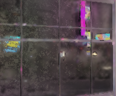
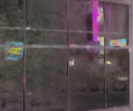
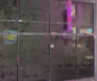

# Glass NZR: conditional uncertainty shrinkage and a demonstrated rejection

**Recommendation: keep as research. Reject production adoption of this Haar
intervention on the current evidence.** The implementation and its diagnostic
tests are useful; they do not establish an improved native NZR image. The
candidate has a reproducible thin-line block-phase failure and loses real glint
detail. Its required noise covariance/support is absent from the supplied glass
capture. With that evidence missing, it correctly makes no change.

This work starts at immutable tag `astra-handoff-20261020`, commit
`5d7839a930106cf8fe1ba8dbbc6750509e7f26a8`. The separately audited production
revision is `87e8b7ab2a428bd91d3c044decf7d4dbccd8cefd`. All new files are inside
`research/astra20261020/candidates/05-glass-nzr/`. Production and packaged
baseline references are unchanged. The PR target is `sol/26-integration`.

## What is delivered

- A default-off, stateless CPU candidate with an explicit per-specular-lobe
  uncertainty interface, including local identity when evidence is missing.
- A bounded source-shaped Seed/selector/count probe, four causal
  discriminators, immutable fixture inventory and separately labelled recorded
  controls.
- Development and held-out analytic stage-surrogate experiments with fixed
  parameters, generated-input hashes, masks, per-seed results and negative
  controls.
- Independent review that reproduced known failures before seeing the
  candidate, then broke its general detail-preservation claim.
- Standalone HLSL and a source-shaped additive adapter patch. The shader is
  unreachable and uncompiled; job 08 owns the missing native integration.
- Exact execution records, a machine-readable result, hashes, and surgical
  native/GPU observation requests.

See [the uncertainty interface](src/UNCERTAINTY_INTERFACE.md),
[adapter specification](adapter/ADAPTER.md),
[independent review](notes/INDEPENDENT_REVIEW.md), and
[machine-readable result](RESULT.json).

## Protected settings and actual source route

The protected recommendation remains D16/S256, G2/G3, RR Fallback, DiffuseRR,
ReflectionHistory enabled and NZR Temporal disabled. Glass mode 2 at strength
0.5 retains half the NZR result: strength is the **NZR fraction**, not the raw-RR
fraction. No global setting or material ID was changed.

Temporal OFF is not equivalent to disabling every reference/history ingredient.
In the protected specular route, native scheduling reaches:

`History → Seed → Refine → Base → HybridPrep → HybridBlur → HybridApply`.

The alternative Accumulate/ReferenceFilter and Select* paths are not this
route. DiffuseRR bypasses the diffuse NZR loop after the original RR copy.
HybridApply takes alpha from the raw/current output. Native SameLighting and
ReferenceTrust also remain set in this route; these affect the authority of the
reference before detail restoration. The detailed source trace and pinned
source citations are in [MECHANISM.md](notes/MECHANISM.md).

This distinction changes the investigation. HybridPrep adds a filtered
`history_mean − Base` departure and derives uncertainty from luma moments and
history count. Its mature-neighbour support and HybridBlur do not perform the
same geometry rejection as a fully validated virtual-reflection support model.
History itself follows a virtual point and validates old taps by hit-distance
agreement. Ordinary surface motion is not interchangeable with reflection
motion. These are source observations, not diagnoses established from the
cropped output alone. [Source trace](notes/MECHANISM.md)

## Data that actually exists

The full inventory, array dtypes, per-array/archive hashes, source identities,
moving crop origins and available-history counts are in
[recorded.json](evidence/recorded.json). NPZ files were loaded with
`allow_pickle=False`; the initial package check verified 91 frozen files and
141 safe arrays. Python 3.12.14 and the required NumPy 2.3.5 were available, so
no dependency substitution was needed.

| Fixture | Chronological frames | Width × height | Useful roles and limits |
| --- | --- | --- | --- |
| Glass 87ee | 46–63 | 192 × 160 | Camera-aligned raw specular RGB, old NZR RGB reconstructed losslessly from XOR, equal diffuse RGB, fixed mask; geometry/MV arrays are unwarped. No input radiance, original alpha, internal NZR states, or truth. |
| Bottle track | 180–186 | 128 × 256 | Original typed input D/S, raw/selected RR D/S, normal/depth/MV, controls and moving crop origins. Partial history; crop motion is not scene motion. |
| Foliage band | 43–65 | 192 × 64 | Same original roles; multiple layers, no semantic foliage/glass label. |
| Facade tile | 34–49 | 96 × 96 | Same original roles; small static-structure control, not its old full-ROI benchmark mask. |
| Portable anchor | Stored combined/native-policy grids | Per manifest | Already-recalled keys and stored shader fields; not raw six-slice history or a new GPU execution. |
| Portable colour | Frame 63 and synthetic controls | Per manifest | CPU-warmed history plus one historical GPU frame; not an independently replayed native temporal sequence. |

The glass mask has **6,497 pixels**. The old **8,048-pixel** number refers to a
separate 512×512 full-ROI receipt, which cannot be recomputed from this small
crop. Glass source origin is `(546,347)` in a `(1505,847)` render. Its odd global
y phase and camera alignment make an origin-zero 2×2 filter over these RGB
arrays unsuitable for asserting native block/geometry parity. We never combine
its aligned RGB with unwarped normals as if they shared coordinates.
[Fixture inventory and masks](evidence/recorded.json)

Most pixels in the other clips have no old NZR specular change: only 152 of
229,376 bottle pixels, 526 of 282,624 foliage pixels and 1,090 of 147,456 facade
pixels differ. These are whole-crop counts and do not contradict the narrower
historical bottle-mask identity receipt. Raw/selected diffuse words match in
the bottle and foliage clips; the old facade outputs have 3,270 differing
diffuse words. These are observed historical differences, not edits by this
candidate. There is no new blanket diffuse-equality claim for that capture.
[Exact crop comparisons](evidence/recorded.json)

No numerical puddle history is bundled for this task; the old 301-frame zero
overlap finding is a historical receipt. There are no converged same-pose
references, original glass internal fit/selector tensors, error covariance,
complete pre-window history, full game, or executable AMD RR provider here.

## Questions fixed before implementation

[PRE_REGISTRATION.md](notes/PRE_REGISTRATION.md) preserves H1–H4, the distinct
predictions, fixed parameters, development seeds 1000–1015 and held-out seeds
2000–2047. The independent reviewer first reproduced rejected soft2 with the
expected quality-gate exit 1, the original Glass trade-off, a blur null and a
frozen-specular null. Only then did they inspect the candidate.
[Pre-candidate receipts](evidence/reviewer_controls.json)

### H1: robust fit/support creates a component of the speckle

The bounded `seed_flat_patch` probe follows the tagged Seed first fit, Tukey
second fit and fallback with caller-supplied flat geometry. It models half
colour storage but uses float64 fitting; it is not an exact HLSL port and omits
guide construction, Refine, hardware arithmetic and provider processing.

Across 256 independently seeded sparse patches with analytic constant truth
0.03, changing only full-5×5 versus diamond support changes 31/256 estimates at
one sample, 86/256 at four samples and 168/256 at sixteen samples. The fixed
downstream selector is identity. At one sample, the full-support robust estimate
has mean 0.006850 versus unweighted patch mean 0.029125; at sixteen independent
samples its mean is 0.028494. Thus support and the centre-conditioned robust
statistics can change the observed pattern and introduce bias in this synthetic
construction. This does **not** establish the cause of the recorded glass noise:
the native Refine/history/support fields are missing, and native reflection
history is not sixteen independent copies of this toy.
[H1 measurements](evidence/causal_probes.json)

### H2: noisy selector/gain creates dots or flicker

The source-shaped pre-Glass equation is
`S = D + w * (k * R − D)`. Controlled current-RGB experiments separately inject
selector and gain noise. Replacing only the noisy component removes its error;
replacing the other does not. Freezing the output scores well on a temporal
quantity while giving a light-step response of zero.

The same observed R/S pair also admits a different latent D/w/k decomposition
to floating-point roundoff. Therefore output-only observations cannot uniquely
decide between a noisy reference, selector and gain. A freeze-selector/gain
native diagnostic needs their actual intermediate tensors, not an inverted
guess from selected RGB. [H2 interventions](evidence/causal_probes.json)

### H3: history count is not measured independent uncertainty

For the source-expected count cap N=16, the recurrence becomes an EMA with
alpha=1/16. The tagged host initializes this cap and uploads the history constant
buffer without a visible override; the live uploaded buffer has not been observed.
In a stationary, no-warp scalar AR(1) toy of input variance one,
the exact mean variance and expected HybridPrep proxy differ:

| Correlation ρ | Actual mean variance | Expected `(moment − mean²)/16` | Actual / proxy |
| --- | ---: | ---: | ---: |
| 0 | 0.032258 | 0.060484 | 0.5333 |
| 0.5 | 0.089184 | 0.056926 | 1.5667 |
| 0.85 | 0.285360 | 0.044665 | 6.3889 |
| 0.95 | 0.557604 | 0.027650 | 20.1667 |

The same source proxy can overestimate or underestimate uncertainty depending
on correlation. This is an analytic falsifier of a count-only interpretation,
not a measurement of the game's correlation. Warping, FP16 moments, nonlinear
sanitization and cross-stage covariance add further limits.
[Formula, source-shaped probe and numbers](evidence/causal_probes.json)

### H4: virtual feature motion differs from surface motion

In a known-truth reflection moving two pixels per frame across a fixed surface,
surface-zero-motion history gives feature MAE 0.025906 while the true virtual
correspondence gives 0.001772. Even the latter still has a 17.5% first-frame
feature response error after a 1.25× lighting step because its own EMA lags.
This distinguishes motion support from averaging and shows why a surface-MV
improvement cannot be credited as reflected-feature transport validation.
[H4 construction](evidence/causal_probes.json)

## Candidate and explicit assumptions

The independent candidate operates on current pre-Glass correction `C=S−R`.
Each 2×2 block is transformed into one low and three high vector Haar bands.
For each high-band RGB coefficient h it uses:

`gain = max(0, 1 − expected_noise_trace / max(dot(h,h), tiny))`.

One scalar scales the RGB vector; the low coefficient remains separate. The
expected high-band noise trace is one quarter of the four pixel traces **only
under the supplied spatial-independence contract**. `Var(S−R)` must include S/R
covariance. Native history count, temporal RGB variance and zero material IDs
do not provide those quantities.

Every tap must have valid current evidence, eligible original support, the same
nonsemantic surface partition, finite/range-valid RGB and effective support at
least eight. The whole block abstains on invalid support or reconstructed
negative/nonfinite/out-of-range RGB. Partial borders abstain. OFF or missing
sidecar returns selected bytes without examining optional metadata. There is
no temporal RGB buffer. The existing Glass policy is applied afterwards.
[Implementation and contract](src/UNCERTAINTY_INTERFACE.md)

The scale is fixed at 1.0 and effective-support gate at 8. The latter is a
disclosed research guard, not a measured native confidence guarantee. The
synthetic sidecar is supplied analytically; its nominal support annotation is
not an observation of 64 chronological native samples. No estimator for these
native sidecars is supplied, and no per-scene threshold was fitted.

## Held-out results

The root agent executed the holdout once after freezing candidate arithmetic:
**240 sequences = five models × 48 independent seeds**, each 32 chronological
frames at 40×56. The generator includes text, thin coloured lines, two glints,
low light, glass/opaque support, a moving reflected feature with an abrupt
shift, new visibility, count/reset cases, a 1.25× light step and a colour step.
There is no looping or reused static noise history.

Raw RR and selected NZR in this suite are **analytic current-frame stage
surrogates**, not AMD or native NZR executions. All controls share generated
truth, input noise, immutable masks and denominators. Truth is used for
evaluation and for choosing the detail-matched scalar comparator, never by the
candidate. Means below come from [synthetic_holdout.json](evidence/synthetic_holdout.json).

| Noise model / measure | Existing Blend.5 | Candidate + Blend.5 | Equal-texture scalar control |
| --- | ---: | ---: | ---: |
| Gaussian grain high-pass error RMS | 0.0071358 | 0.0055515 | 0.0069703 |
| Gaussian positive quiet sparkle p99.5 | 0.0181216 | 0.0159097 | 0.0176887 |
| Gaussian texture gain | 0.526100 | 0.514220 | 0.514220 |
| Gaussian isolated-glint gain | 0.530943 | 0.475222 | 0.519189 |
| Sparse-tail grain high-pass error RMS | 0.0191193 | 0.0159852 | 0.0169841 |
| Sparse-tail positive quiet sparkle p99.5 | 0.0888468 | 0.0868869 | 0.0789950 |
| Sparse-tail texture gain | 0.525603 | 0.472116 | 0.472116 |
| Sparse-tail isolated-glint gain | 0.527178 | 0.360594 | 0.474498 |

Using the mean of paired per-seed ratios, Gaussian grain decreases 22.21% and
temporal error 13.14% versus Blend.5, while texture gain falls 2.26% and isolated
glint gain 10.52%. Under sparse heavy tails, grain decreases 16.40%, texture
gain falls 10.18% and isolated glint gain falls 31.87%. These are modeled
trade-offs, not lossless improvements.

At equal texture regression gain, the sparse-tail candidate has **9.99% worse
sparkle p99.5** and **24.31% lower glint gain** than simply reducing correction
strength; all 48 held-out seeds show the worse sparkle direction. Its temporal
error advantage over that scalar control is only about 0.38%. It therefore
does not dominate the appropriate null. Honest AR(1) effective support and
honest spatial-correlation metadata reject every block and give exact identity.
The false-independence scenario is deliberately invalid metadata, not a
deployable success case. [Paired distributions](evidence/synthetic_holdout.json)

Blur greatly reduces grain but drives Gaussian texture gain to 0.0860 and
glint gain to 0.0932. Frozen Blend.5 has zero immediate light/colour response.
The candidate's mean immediate light response remains near one in the supplied
stateless scenes, but that cannot guarantee retention of an arbitrary new
subnoise reflection or colour change. Full response, moving-feature, edge,
low-light, tail and per-seed ranges remain in the evidence rather than being
collapsed into a single quality score.

## Independent rejection and fixes made during review

The reviewer did not tune the candidate. Across 128 independently seeded
realizations, a two-pixel bright line retains approximately **99.01%, 81.79%,
98.91%, 82.10%** amplitude at four block phases: **17.21 percentage points** of
position-dependent modulation, despite whole-image RGB sum error below 9e-7.
This can produce motion-dependent detail variation without any temporal state.
Block low-band preservation does not establish line or local-energy
preservation. [Independent phase probe](evidence/reviewer_adversarial_measurements.json)

Correlated high-band noise has 3.9469× the coefficient variance predicted by the
false spatial-independence assumption. Correctly marking independence false
preserves identity. A separate two-world construction gives identical inputs
for a genuine small glint and a sparkle; the glint's incremental peak falls
from 0.08 to 0.02, a 75% loss. The final witness includes a uniform correction
on all four taps so every tap meets the adapter's original-changed support.
The earlier API-only witness is retained with its narrower scope.
[Independent review and provenance](notes/INDEPENDENT_REVIEW.md)

Before holdout, the initial development evaluator's broad sparkle label was
corrected: quiet-flat p99.5 tails now measure noise, while all-active high-pass
error tails remain separately named because they include text blur. The first
development JSON is retained. Candidate parameters/arithmetic were unchanged.
Source-subset input range and pre-quantization directional support checks were
also corrected following review; current low-value 0/1-support H1 results are
unchanged. Glass mode 3 is explicitly unsupported by this bounded policy API.
No quality tuning followed the phase failure or held-out results.

## Recorded controls and exactness

Legacy fixture calibration reproduces its original formulas: Blend.5 changes
fine temporal CV from 0.084531 to 0.060510 while detail energy changes from
0.000669272 to 0.000474707. This legacy CV uses each variant's own brightness
denominator. For new comparisons, every denominator is fixed from unchanged
BASE; the two conventions must not be mixed.

| Recorded control, common 6,497 pixels | Fine CV, fixed BASE | HP CV, fixed BASE | Detail proxy |
| --- | ---: | ---: | ---: |
| Old NZR-selected | 0.084531 | 0.032389 | 0.000669272 |
| Raw RR | 0.074530 | 0.028018 | 0.000317819 |
| Blend.5 | 0.073601 | 0.029968 | 0.000474707 |
| Blend.75 | 0.078658 | 0.030968 | 0.000569234 |
| Candidate, missing sidecar | 0.084531 | 0.032389 | 0.000669272 |
| Candidate + Blend.5, missing sidecar | 0.073601 | 0.029968 | 0.000474707 |

These are aligned signal-plus-noise proxies without truth. The substantially
different fixed-denominator reduction reinforces why the original percentage
must remain attached to its original protocol. Edge-band and BASE high-detail
quartile measurements, sparkle tails and flicker are separately available.
The edge band is the boundary of immutable eligibility, not verified geometry.
[Recorded measurements](evidence/recorded.json)

Candidate identity is measured on **350,838 RGB words in the actual
NZR-changed common subset**, with zero differing words and zero max error.
There are also zero changes outside the common mask. This is an exact
abstention result, not a high all-pixel identity score passed off as denoising.
Diffuse data were kept unchanged by the CPU experiment; original glass alpha
is absent and is instead tested with controlled bit-pattern inputs and requested
from the native run. No new 18,874,368-word/full-ROI GPU claim is made.

The following images use frame 55, identical 192×160 crop and the fixture's
fixed exposure/tonemap. They are pre-remod diagnostic lobe sums, not game
screenshots or a new candidate win.

| Old NZR | Existing Blend.5 | Raw RR |
| --- | --- | --- |
|  |  |  |

## Execution and local acceptance gate

Run the complete CPU checks from the repository root:

```sh
python -m pip install -r research/astra20261020/requirements.txt
python -B research/astra20261020/candidates/05-glass-nzr/run_checks.py
```

The root full run returned zero in 39.023 seconds. It includes all four frozen
CPU suites, 35 candidate/source/recorded/independent tests, source-shaped probes,
fixture inventory, additive-patch applicability, and the held-out suite. Two
subcommands deliberately return one: the known rejected soft2 quality gate and
the alpha-authority fault injection. The wrapper checks those exact expected
failures; it does not relabel an unexpected failure as success.
[Full execution ledger](evidence/root_full_run/execution.json)

For a subsequent contract-only check, use `run_checks.py --skip-holdout`.
This is explicitly not another holdout execution. Published hashes describe
the delivered snapshot; a fresh full reproduction naturally records new timing
fields. Baseline-before-change output is retained in the evidence directory.
The final contract check also returned zero in 12.966 seconds with all 35 tests
and both expected failing controls. It did not regenerate the held-out data.
[Final contract execution](evidence/root_contract_rerun/execution.json)

The scoped production patch adds only an unreachable shader. OFF integration
must dispatch no new pass and preserve the existing native graph; merely
dispatching a copy shader is not native bitwise OFF equivalence. An eventual
ON path needs actual float32 pre-Glass staging, immutable raw RR, a validated
uncertainty producer, distinct output, unchanged Glass policy and raw alpha.
It introduces work whose GPU cost is unknown. There is no compiled CSO,
generated header, DLL, AMD RR run, game observation, GPU timing or resident-VRAM
measurement in this deliverable. [Adapter and build request](adapter/ADAPTER.md)

[GPU_REQUEST.json](GPU_REQUEST.json) separates a small standalone arithmetic
parity run from actual native diagnostic capture and final game A/B.
[BLOCKED_DATA_REQUEST.json](BLOCKED_DATA_REQUEST.json) identifies the missing
observations, competing outcomes, tensor roles/units, chronology, crop/phase,
provenance and maximum useful payload. The requests retain Blend.5 and a
same-layout sham performance control. Data collection does not override the
independent phase/glint rejection: this exact design remains research even if
shader parity succeeds.

The useful next step is to identify reference/selector/support uncertainty at
the actual native stages, using the proposed interventions and original masks.
Inventing a covariance from the cropped final output or enabling generic
temporal smoothing would not resolve the demonstrated ambiguity or respect the
user's accepted sharp Temporal-OFF baseline.
