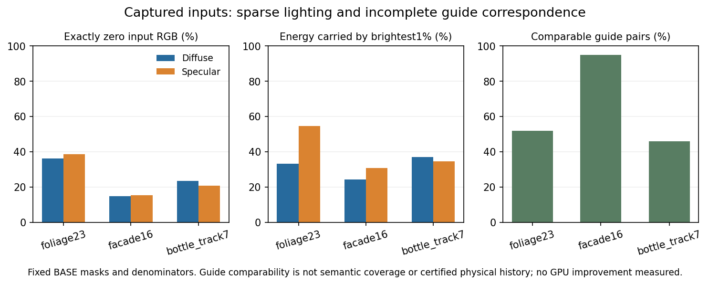
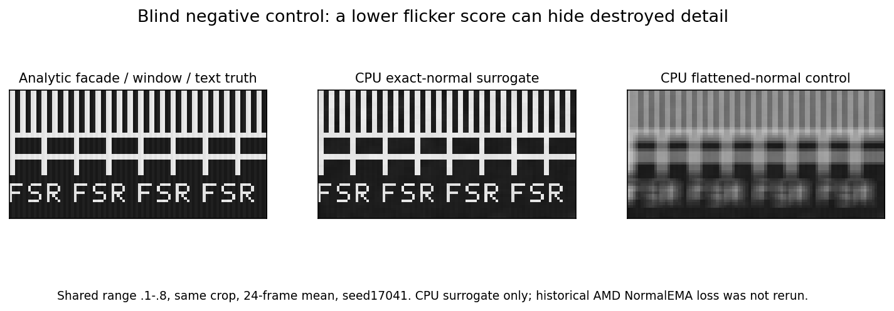

# Job 07 — mixed-coverage guide investigation

## Decision and delivered implementation

**Keep the original-guide observer as research. Reject production activation of
the tested cosine history consumer.** The observer supplies useful diagnostic
measurements while preserving normal/depth/material/roughness, motion, physical
D/S and hit-distance alpha. Its experimental history multiplier is not a
calibrated probability or an AMD API input. Neither captured foliage improvement
nor final-game improvement has been established.

The strongest tested active interpretation slightly improves detail in a simple
CPU denoising surrogate but makes held-out sparkles and flicker worse. A separate
analytic experiment shows why a guide-only confidence interpretation cannot
solve every mixture: identical observed guides can correspond to different
hidden layers and require different transport. Additional smoothing cannot
recover information that the guide representation did not retain.

The reproducible deliverable includes the layered generator, original-guide
observer, deliberately limited CPU reconstruction surrogate, fixed BASE masks,
real-clip diagnostics, independent bad controls and review, HLSL diagnostic
proposal, exact adapter specification, local GPU request and surgical data
request. [RESULT.json](RESULT.json) records source revisions, paths, commands,
versions, executors and hashes. [README.md](README.md) provides the one-command
entry point.

### Workstream boundary

The task branch starts at immutable tag `astra-handoff-20261020`, resolved to
`5d7839a930106cf8fe1ba8dbbc6750509e7f26a8`. The distinct audited production
baseline is `87e8b7ab2a428bd91d3c044decf7d4dbccd8cefd`. All modifications are under
`research/astra20261020/candidates/07-foliage-guides/`; production and frozen
package references remain unchanged. The integration target is
`sol/26-integration`. This work does not install or build a game DLL.

## 1. Source mechanism and observable contract

The source investigation followed the actual native Bridge geometry/material
entry points, material capture/quantization helpers, callers, RR wrapper,
LightingGuard and trace schema. Its detailed references and hashes are in
[MECHANISM.md](MECHANISM.md) and [source_audit.json](evidence/source_audit.json).

The native guide is `R10G10B10A2_UNORM`: octahedral world-normal coordinates in
RG, linear roughness in B and a two-bit categorical equality code in A. It is
not a vegetation/glass segmentation channel. The native material-preservation
option is separate; “original” in `recovery_original_normal_roughness` means
pre-Flat-Albedo bridge input, not an unseen per-sample native GBuffer.

The geometry pass already has a distinct **R8_UINT raw-depth validity** resource.
Its meaning is not overwritten. The examined RR dispatch does not expose an
independent guide-uncertainty resource. G3 reads original `sourceInput` D/S;
native Anchor's private physical D/S, when enabled elsewhere, continue to serve
RR and NZR. A normal uncertainty proposal must not silently change this routing
or reuse G3's motion-B invalidation intervention.

### Implemented observer

`src/foliage_guides.py` uses only supplied packed guides, depth, motion and
chronology/crop metadata. Hidden synthetic layer truth and radiance are excluded
from its inputs. It reports:

| Field | Meaning |
|---|---|
| Angular dispersion | `clamp(1 - length(mean(normal)), 0, 1)` over finite positive-depth samples in a 3×3 neighborhood |
| Relative depth span | Neighborhood `(maxDepth-minDepth)/currentDepth`; extreme positive overflow saturates to FLT_MAX and is documented |
| Temporal innovation | Bilinear-weighted `1-dot(currentNormal, previousNormalTap)` from four explicit original-guide taps |
| Numerical support flags | Current finite values, spatial support, finite motion, chronology, complete previous footprint, category and depth compatibility |
| Experimental cosine multiplier | `clamp(1-innovation,0,1)` on comparable evidence; identity 1 otherwise |

All four prior taps must exist, including zero-weight taps, and agree in category
and expected depth within the frozen 2% tolerance. Predicted depth must be finite
and positive; the caller must establish compatible positive-linear depth and
motion-B units. Current and previous crop origins enter the coordinate formula:

```text
previousLocal = currentLocal + currentRenderCropOrigin
              + motionRG * originalRenderExtent - previousRenderCropOrigin
```

The CPU and proposed HLSL use explicit float32 arithmetic and point-tap
interpolation. This is not a claim of equivalence to hardware sampler fraction
quantization. First-frame history, frame gaps/reset, unknown conventions,
outside-crop taps and invalid prediction remain unsupported.

**Unsupported innovation 0 is a sentinel, not measured agreement.** The
multiplier remains 1, preserving consumer behavior. Statistics retain fixed BASE
support and separately disclose supported-only diagnostic distributions and
their counts. `TEMPORAL_SUPPORTED` means numerical comparability of observed
fields; it does not prove valid raw geometry, homogeneous coverage or legitimate
composite history. The supplied raw validity and per-sample coverage limitations
are explicit in the tests and adapter contract.

## 2. What the recorded data can establish

The package contains typed arrays, not complete replay contexts or converged
truth. All NPZ loads use `allow_pickle=False`. Source hashes, original words,
chronology, crop origins and frame counters are preserved. Camera words exist;
timestamps/frame durations, albedo in the three clips, per-sample ownership,
per-layer motion and final game composite are absent.

| Clip | Capture frames | Crop width × height | Original render | Coordinate limitation |
|---|---|---|---|---|
| foliage23 | 43–65 | 192×64 | 1505×847 | Fixed origin (752,423); region name is not a semantic mask |
| facade16 | 34–49 | 96×96 | 1505×847 | Fixed origin (688,359); does not replace the historical whole-ROI facade mask |
| bottle_track7 | 180–186 | 128×256 | 1505×847 | y origin moves through 160,176,208,272,384,480,560; mask also includes hand/arm |

Original/provider normal bits are identical in every pixel of all three tiles.
Only roughness changes: **526/282,624** foliage pixels, **1,090/147,456** facade
pixels, and **152/229,376** bottle pixels. Their category codes are zero. These
facts reject the specific claim that the observed prepared/original difference
is a normal-bit modification; they do not certify the native writer's physical
normal or a GPU decoding implementation.

### Fixed support and captured measurements

Before candidate evaluation, masks were frozen from original BASE geometry,
fixed crop interiors and source motion. They include a two-pixel core border,
available previous-crop pairs, original depth/normal edges, a source-motion
mask, and a strict original-guide-compatible pair mask. Candidate values never
select the image-quality region or its denominator. The mask arrays, per-frame
counts and hashes are in [evidence/base_masks](evidence/base_masks).

| Captured measurement | Foliage | Facade | Bottle |
|---|---:|---:|---:|
| BASE core pixel-frames | 259,440 | 135,424 | 218,736 |
| Available previous-crop core pairs | 247,740 | 126,960 | 141,929 |
| Exactly zero input diffuse RGB | 36.11% | 14.91% | 23.49% |
| Exactly zero input specular RGB | 38.47% | 15.36% | 20.83% |
| Top 1% share of positive diffuse luma energy | 33.05% | 24.18% | 36.91% |
| Top 1% share of positive specular luma energy | 54.59% | 30.66% | 34.61% |
| Numerically comparable guide pairs / fixed available pairs | 51.88% | 94.87% | 45.91% |

These measurements are in [captured_baseline.json](evidence/captured_baseline.json)
and [captured_with_candidate.json](evidence/captured_with_candidate.json). Source
RGB lobe units and all original arrays, including alpha and provider/camera
words, remain byte-identical. The first fixture frame has no available previous
frame. The bottle's changing crop leaves about 24.3% of later core pairs outside
the prior crop; these are not clamped into invented history.

Foliage's median nearest-original-normal temporal angle is about **8.24°**, with
p90 **93.93°**. Descriptive Pearson correlations between angular change and
motion-compensated absolute input-luma change are **−0.0162 diffuse** and
**−0.00391 specular**. Substantial input variation also exists on the fixed
strict-guide-compatible subset. These short-window observations show coexistence
of guide variability and sparse/heavy-tailed lighting. They do not prove
independence, a particular stochastic algorithm, or a causal foliage mechanism.
Reported lag correlations are explicitly at local crop indices, not advected
material points. No per-second flicker rate is inferred without timestamps.



### Glass control and calibration fixtures

The aligned glass subset is 192×160 over frames 46–63. Its common aligned mask
has **6,497** pixels; the historical full-ROI 8,048-pixel result is separate.
`original_normal_roughness_u32` is an **unwarped provider/prepared** guide, not the
pre-Flat original role. Its aligned RGB and masks must not be indexed onto raw
guide pixels. This work runs a separately labelled unwarped geometry observer on
a BASE rectangle, and the reviewer independently uses a six-pixel-halo rectangle.
Neither analysis claims a guide/light causal result or uses the aligned mask as
raw geometry support. All glass arrays remain bit-identical; physical noisy D/S
and hit-distance alpha are absent from that subset.

The supplied Anchor fixtures are recalled keys/stats/gain calibration witnesses,
not raw key rings. The colour fixture is one captured frame after CPU-warmed
history, not a native chronological replay. The original package verifier checked
**91 frozen files and 141 safe NPZ arrays**, and all four portable CPU suites
passed before development. The intentionally rejected colour soft2 quality gate
returned **1** for its documented halo regression. Passing baseline tests certify
reproduction of these contracts and failures, not acceptance of their image
quality. Original logs are retained in `evidence/`.

## 3. Controlled synthetic experiments

`src/synthetic_scene.py` constructs supersampled thin cards crossing a textured
rigid background with window frames, glyph-like strokes, sky gaps and depth
boundaries. It retains per-layer lighting/geometry/motion and known discrete
visibility. Opaque geometric, deterministic alpha-test and stochastic coverage
are explicitly synthetic alternatives. A selected subpixel supplies plausible
single-guide observations. D and S have separate FP16 RGBA stores and are added
in float32; alpha is retained. The noise model is a disclosed positive sparse
outlier/AR construction and does not pretend to reproduce the captured zero mass
or ReSTIR.

The frozen protocol changes thickness, orientation, overlap, coverage fraction,
normal quantization, relative motion, noise correlation, coverage/guide rule and
phase one family at a time. Coverage, guide selection and lighting have separate
RNG streams. Fixed/moving coverage and static/moving rigid controls, 1.1× and
1.25× real lighting steps and independent trajectories are included. Analytic
truth and BASE masks are locked before each method is evaluated.

There are **51 protocol rows, representing 40 unique input realizations**. OFAT
tables intentionally repeat a reference; the original development summary is
row-weighted, and a deduplicated summary is provided. Independent
[DEDUP_AUDIT.json](review/DEDUP_AUDIT.json) confirms every repeated input group has
identical truth and masks, so input-only and input-plus-truth grouping agree for
this dataset. The **nine distinct held-out cases** use seeds 9001, 17713 and 29009
with frozen phases, orientations and trajectories. No parameters or thresholds
were fitted to them.

Nine explicit modes compare raw input, the identity observer, single dominant
guide, unquantized exact dominant guide, flattened normal, deliberately wrong
decode, the hypothetical cosine consumer and two privileged per-layer guide
oracles differing in motion. Oracle lighting/current coverage is inaccessible
to production; background oracle normal/depth are layer moments and can still
contain multiple background facets. These are limits of the construction, not
hidden extra candidate inputs.

### Held-out active-consumer result: reject

All values below are **CPU surrogate metrics**, normalized to fixed truth luma
where applicable. They are not AMD RR output. The comparator itself loses
substantial detail; a relative gain over it cannot satisfy the frozen absolute
detail gate.

| Mean across nine held-out cases | Single-guide surrogate | Hypothetical cosine consumer | Interpretation |
|---|---:|---:|---|
| Grain high-pass RMS | 0.224186 | 0.225409 | Slightly worse |
| p99 absolute sparkle error | 0.956242 | 0.970378 | Worse |
| Residual frame-difference RMS | 0.261250 | 0.262606 | Worse |
| Detail-gradient transfer | 0.400072 | 0.412886 | Improved, still below required 0.95 |
| False-history-support fraction | 0.025592 | 0.025592 | No improvement at frozen threshold |
| Cross-layer mixing weight | 0.038370 | 0.038345 | Nearly unchanged |
| First-four-frame true-light response | 0.588069 | 0.613302 | Improved, still delayed/lost response |

Worst paired sparkle regression is **3.80%** on `holdout_facade_17713`; worst
flicker regression is **1.52%** on `holdout_facade_9001`. Every denoising surrogate
misses the 0.95 detail-transfer gate. The observer itself is bitwise identity
against raw input in every protocol row: it makes no noise-reduction claim.
Complete cases, worst cases, fixed weighted scores and denominators are in
[synthetic_benchmark.json](evidence/synthetic_benchmark.json).

### Negative controls separate causes

On the static rigid-facade surrogate, flattened normals reduce flicker while
detail transfer drops **0.44708 → 0.35010**, a further **21.69%** loss. This newly
executed CPU result must not be confused with the package's historical native
NormalEMA .25 loss of 22–27%.

The independent reviewer first built a different facade/window/text control,
before seeing this candidate. Across three frozen seeds, flattening normals
reduced its flicker to about **0.717–0.726×** and sparkle to **0.618–0.651×**, while
signed all-region detail transfer became approximately **−0.08×** and edge error
rose about **11.8×**. The sign means some fine contrast reversed. The correct
scorer rejects all three controls; the deliberately weakened noise-only scorer
falsely accepts them. Its explicit mutation command fails as intended.



With fixed coverage, correlated lighting can preserve the entire guide-sidecar
sequence while p99 error rises **0.65458 → 1.16909** and flicker decreases. The
independent reviewer separately confirmed guide/sidecar invariance under changed
noise correlation and a real light step. In that reviewer's frozen noise case,
flicker fell from 0.95921 to 0.26872 while raw normalized RMSE also improved
slightly, from 0.66833 to 0.64873; it is not a second worsening-error example.
Together these interventions show that guide-only observations cannot identify
the lighting distribution, and that a lower flicker score alone cannot determine
truth agreement.

Ten analytic homogeneous normal witnesses separately test decoding. Correct
10-bit oct quantization gives maximum error **0.14265°** on those witnesses;
deliberately decoding oct-RG/roughness-B as XYZ gives mean error **58.51°**.
This is a calibrated witness set, not a universal worst-case bound or newly
executed native shader validation.

### Identifiability and motion falsifier

The exact guide-collision construction supplies identical dominant normal,
depth, category and motion histories for distinct hidden mixtures. Their true
RGB differs by up to **0.16 synthetic radiance units**, yet the observer produces
identical outputs with multiplier 1. The reviewer's independent temporal version
changes hidden coverage while observable guide innovation remains zero.

The main layered benchmark's oracle-motion difference is small, so it is not
used as strong transport proof. A smaller analytic experiment removes noise,
filtering and bilinear approximation: two unresolved layers with fixed 60/40
coverage move at +0.25 and −0.5 pixels/frame. Exact analytical previous-layer
evaluation gives:

| Transport policy | Normalized RGB RMSE |
|---|---:|
| Correct dominant-layer MV | 0.1354925 |
| Minority-layer MV | 0.3665467 |
| Coverage-mean MV | 0.1756198 |
| Correct separate per-layer motion | 0.0 |

Observed normal innovation is zero. This demonstrates a possible representation
limit even when a dominant-layer MV is analytically correct; it does not assert
that a particular captured game pixel uses this sampling rule. The executable
and output are `src/transport_discriminator.py` and
[synthetic_transport_discriminator.json](evidence/synthetic_transport_discriminator.json).

## 4. Independent review and verification

Roles were explicitly separated: mechanism/source audit, implementation/testing,
and a skeptical reviewer blind to candidate results until its negative-control
calibration and gates were frozen. The reviewer independently reran the final
51-row benchmark, checked source hashes before and after execution, and matched
every case and numeric summary exactly. It independently replayed all three
recorded clips and added a separately scoped glass guide control.

Review found and corrected real experimental/code errors before the final
source freeze: NumPy IntFlag casting, finite-positive predicted-depth admission,
extreme span overflow, NumPy-scalar float64 promotion of coordinates, ambiguous
“exact” guide witnesses, coupled random streams, x-only detail scoring, executor
attribution, unsupported-zero presentation, and repeated-input accounting.
These are documented in [review/REVIEW.md](review/REVIEW.md); no failed run is
reported as a passing measurement. The full CPU entry point records expected
mutant failures, actual exits/timings and before/after source hashes in
[final_checks/verification.json](evidence/final_checks/verification.json).

The HLSL proposal reads real normalized packed-guide SRVs and writes only an
independent RGBA32F moment texture and R16_UINT flags. The 64-byte/16-DWORD host
constants layout passed a portable GCC 13.3 C++ syntax/static-assert check.
**DXC was unavailable; HLSL compilation, DXIL validation, Windows host build,
native execution, GPU timing/VRAM and final-game observation were not performed.**
No compiled shader bytes or DLL are presented. Source and exact build flags are
in [adapter/BUILD.json](adapter/BUILD.json).

## 5. Remaining hypotheses and local decision gate

| Hypothesis | Evidence here | What remains unresolved |
|---|---|---|
| H1 coverage/guide mixture | Synthetic phase/layer constructions and exact observational collisions | Native per-sample coverage and writer selection rule |
| H2 decoding/quantization | Known-normal CPU witnesses; original/provider normal words identical in clips | Actual compiled shader and native writer/material witnesses |
| H3 sparse/correlated lighting | Captured zero mass/tail energy; fixed-guide synthetic noise interventions | Native stochastic provenance and controlled same-pose truth |
| H4 single-layer motion | Exact analytical two-layer transport counterexample | Native per-layer correspondence/visibility and pre-G3 motion lineage |
| H5 detail destruction | Two independent CPU controls reject apparent flicker wins | Original full historical facade/text native masks and actual native A/B |

The smallest useful next data is described in
[BLOCKED_DATA_REQUEST.json](BLOCKED_DATA_REQUEST.json): approximately **8.36 MiB**
of additional tensors for the existing foliage crop, plus about **5.25 MiB per
16-frame 64×64 known-normal/known-motion control**, before compression and small
metadata. Existing unchanged guide/D/S/RR arrays should be referenced by hashes,
not uploaded again. Unavailable sample truth stays unavailable.

Job04 can transport the diagnostic only with explicit frame/context/source and
transport validity; it cannot turn the observation flags into physical history
permission. Job08 has an exact
[diagnostic-only adapter specification](adapter/PRODUCTION_SPEC.md), with
default-OFF zero dispatch/allocation, source-state restoration, immutable
previous snapshots, descriptor/generation validation and fence ownership.

Local acceptance in [GPU_REQUEST.json](GPU_REQUEST.json) requires actual compiled
native execution, word-identical original/provider inputs, D3D debug/lifetime
checks, fixed original masks, historical facade/window/text and moving
person/bottle/sky/glass controls, then matched final video for any later active
change. D16/S256, G2/G3 and protected NZR settings remain intact. Until that
evidence exists, **foliage is not declared solved**.
