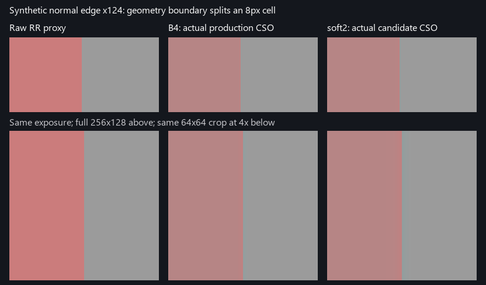

# Portable native-colour CPU research

This package preserves the audited B4 CPU baseline and the **rejected** C8/soft2 candidate. It does not contain a new production colour fix. There are no Windows, capture-loader, D3D12, GPU-runner, or game-DLL imports. Runtime dependencies are Python's standard library and NumPy; the recorded Windows run used NumPy 2.3.5. Linux execution has **not** been performed.

From this directory:

```sh
python -m pip install -r requirements.txt
python -B -m unittest -v
python -B compare.py
python -B compare.py --quality-gate
```

The last command is expected to exit **1**: it detects a known halo regression in soft2. A green unittest run means the numeric contracts and the known rejection are reproduced; it does not approve soft2's image quality. Comparison commands print JSON and do not write files.

## Contents and equivalence

- `colour_portable.py`: unchanged source bodies for 16 math/model blocks, plus the original NumPy Gaussian convolution with only its optional GPU dispatch removed. `baseline_model()` constructs B4 (4px cells, 5×5 step2 kernel); `rejected_soft2_model()` constructs C8 (8px cells, 5×5 step1 and RR-colour guide). `rejected_soft2_apply()` is the original sigma.4/gradient/bilinear-fallback/confidence2 JBU.
- `compare.py`: one captured-frame comparison and 4 edge kinds × 8 grid phases. Synthetic targets specify the unchanged side exactly; that side must not acquire colour from its neighbour.
- `test_colour_portable.py`: RTZ, all 2,048 exact FP16 normal payloads, ideal interpolation, signed depth, luma storage bounds, captured arrays, and the shifted-edge counterexample.
- `fixtures/soft2_gpu_87ee63.npz`: byte-identical copy, **9,101,728 bytes**, SHA-256 `0e5cf3dd35a5a4ae4f39aad4480e7d89cb92d0217530f06a412fb501605a2ec2`.
- `fixtures/provenance.json`: source file/function hashes, array shapes/dtypes, capture/render/crop coordinates, stored motion conventions, and precision/history/domain limits.
- `verification/`: actual Windows CPU import, source-equivalence, test and comparison records. No Linux or new GPU execution is claimed.
- `evidence/`: previously measured GPU counterexample images/JSON, copied as evidence. These GPU jobs are not rerun by this package.

Source equivalence was checked by matching the 16 function/class AST fingerprints, then executing the original ASTs without their machine-specific module top levels. Both models' four chronological random frames produced identical outputs, gain fields and histories. In the stored captured frame, stats/history/gain/packed-normal/bilinear outputs are exact.

The stored `expected_soft2` is different: its original JBU guide used pre-UAV float32 RR colour, while `rr_rgb` stores the RTZ R16-expanded colour. Those low bits cannot be reconstructed. The export does not alter the algorithm to hide that loss. Measured reproduction max abs error is `6.103515625e-5`, p99 is zero; see `verification/comparison.json` for the exact half-ULP count.

## Fixture meaning and limits

Capture `87ee1fba-b8bc-4660-aa3f-d06db7bf863f`, published frame 63 of 66, is a true **512×512 ROI**, origin `(496,167)` within render `(1505,847)`. `prev_history` was computed once by the CPU on chronological frames 0–62. It is a C8 state on a **64×64 grid**, not a B4 128×128 state and not a full GPU history. Do not feed it into B4 or use this one frame to rank temporal noise/ghosting.

Input RGB and raw RR RGB are captured diffuse+specular **pre-remod lobe sums**. Skip was not captured. The exact subsequent game remod factors are unknown; input colour is a drift proxy, not ground-truth colour. Preserving each model pixel's luma does not prove that the final game composite preserves luma. The originally audited combined colour path also did not run on these captures' native bridge route; this CPU package makes no native integration claim.

Use `motion_px` directly: it is original captured UV multiplied by the original **1505×847** render size before cell averaging. `motion_uv_original` retains that original convention. `motion_uv_roi` is an alternative rescaled/half-rounded convention, not interchangeable input. Crop dimensions must never replace the original render scale. Motion channel B/depth are retained in their captured units.

`bilinear()` deliberately preserves the original continuous NumPy interpolation. On the audited GPU, fractional interpolation quantization changed the hard 2% history-depth gate in **9/4096** cells; a 1/256-fraction model reproduced those gate decisions. Actual sampled history then agreed with the independent track calculation within 1 half ULP. This package does not silently substitute a new sampler. The recorded frame 63 GPU vs CPU output max error is **.008789**, despite p99 `1.526e-5`. Good p99 is not full temporal parity.

## Why soft2 remains rejected

On unlooped captured CPU windows, soft2 reduced chroma high-frequency temporal p90 by 11–13% against B4, and 57% on a static control. These gains did not establish boundary safety. An independent GPU phase sweep found:

- normal edge splitting an 8px cell: right-side contamination `.057180 → .098075` (**+71.5%**);
- depth edge splitting an 8px cell: `.057180 → .097520` (**+70.6%**).

Both outputs in that comparison came from actual CSOs with identical RTZ input bytes. The image uses the same exposure/crop; the lower panel enlarges a square crop isotropically.



The target mean of a mixed cell loses the subcell boundary. Bilinear fallback can spread its gain across that boundary; hard identity fallback lost most of the measured noise benefit. A follow-up keeping 4px cells but using dense 9×9/step1 support reduced static p90 by 45%, but only 4% in the turn window and worsened some edge phases by14–15%. Increased averaging alone is not a verified solution.

Three dead ends to preserve:

1. Raw-pixel black/absolute-dark confidence: a zero 1spp input can be a missing stochastic sample. The gate flickered and increased the known-bad NZR region's chroma p90 by35% in one window. `apply(dark=True)` exists only because the source function body was preserved; it is not the recommended path.
2. Coarse cells plus 4-tap guided upsampling: aligned edges looked excellent, shifted normal/depth edges failed. Include all phases; do not repeat only the favourable alignment.
3. Slower/variance-gated EMA as the sole repair: it reduced jitter while delaying colour response. In a controlled one-frame flash toy, strong variance guards reduced response from `.242` to `.022/.014`. That toy was not an AMD RR replay. Neither it nor a single mean-colour score proves correct game lighting.

The next useful work is specified in `OPEN_TASK.md`. Chronological raw-array fixtures are supplied separately by the handoff lead; do not fabricate time sequences from this single frame, loop it into steady state, or treat the prior CPU state as a multi-frame GPU proof.
